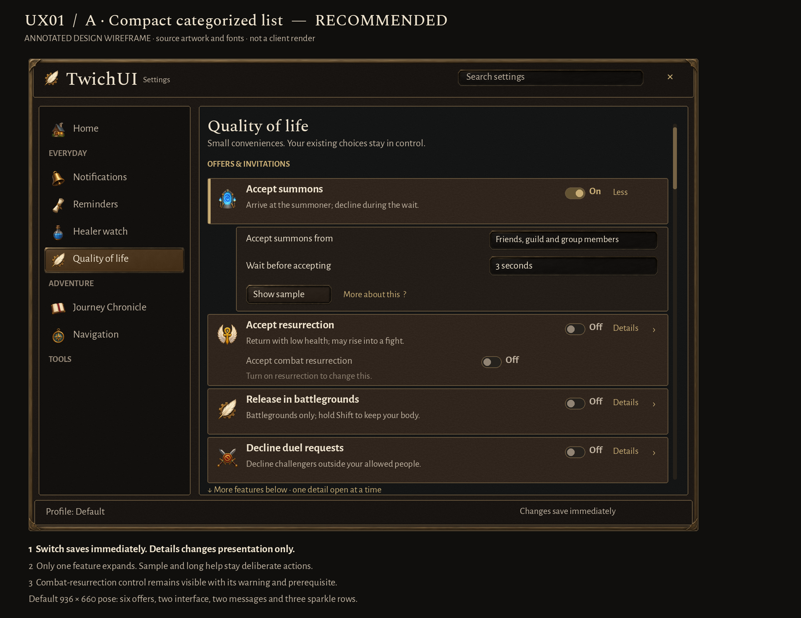
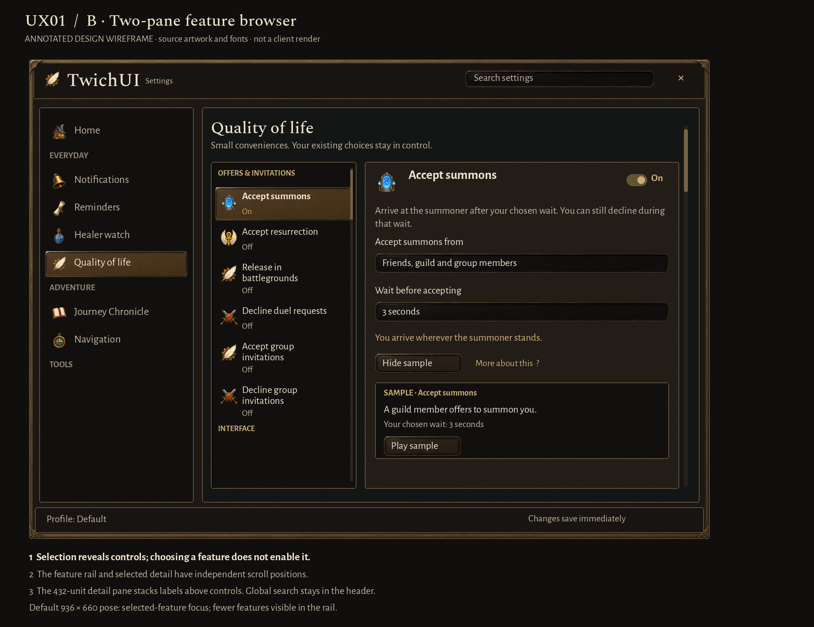

# UX01 — Quality of life design review

**Owner-authorized Batch 8: design and discovery only.** Based on `main` at
`f21db0aa1c0a04bad532b30d70c39a001fc7a6d9`, after PR #128. No live interface,
setting, default, runtime handler or SavedVariables schema changes in this PR.
UX02 #129 and the active Market, Ledger and action-glow branches are untouched.

**Recommend A: compact categorized rows with one inline detail open at a time.**
It retains the existing page scroll and gives controls the full content width.
B is a credible alternative when switching among many feature details, but its
second navigation rail and narrower detail area add complexity for this page.
Owner approval of the visual direction is the boundary before implementation.

- [Complete existing-control inventory](qol-settings-control-inventory.md): all
  22 persisted controls, defaults/identifiers/options, runtime caveats, seven
  Leatrix mappings, nine samples, reset, global search and profile ownership.
- [Layout exploration](qol-settings-layout-exploration.md): shell measurements,
  feature/group placement and source-grounded tradeoffs.
- [Preferred implementation specification](#proposed-implementation-specification).

## Visual proposals

These are **annotated styled wireframes**, not finished high-fidelity client
renders or simulator screenshots. The simulator installation is unavailable.
They use existing bundled materials, painted sheets, feature icons and fonts;
no runtime art was created or regenerated. Geometry is specified in logical UI
units; exported pixels are 2× for reading. Synthetic On/Off selections illustrate
the design; the addon still defaults these conveniences off.

The shell keeps its default 936 × 660 proportions, 212-unit global navigation,
54-unit header, global search, footer/profile control and 644-unit page width.
The wireframes simplify native hover/focus, exact font metrics and the sample
illustration. The shown navigation is the visible prefix of the existing groups,
not a proposed navigation redesign. Source scrolling reveals the remaining rows;
the images do not imply all 13 features fit on one screen.

### A — Compact categorized list, recommended

Primary switch and On/Off remain in each row; **Details** opens its secondary
controls inline. Only one feature expands, while the other rows remain concise.
The combat-resurrection setting stays visible even when its detail is closed.

[Collapsed overview](ux01/option-a-overview.png) ·
[Minimum-height 936 × 480 view](ux01/option-a-minimum.png)

### B — Two-pane feature browser

Select a feature on the left; use its controls and optional sample on the right.
The feature rail displays name, icon and state. The selected detail supplies the
purpose and full help. Selecting a feature never enables it. Unlike A, toggling
an unselected feature requires selection first, so the consequence is visible
before the immediate change. The 200-unit list plus 12-unit gap leaves a 432-unit
detail at default width; labels stack above inputs instead of squeezing controls.

[Minimum-height 936 × 480 view](ux01/option-b-minimum.png)

B would need independently scrollable list/detail regions and clear keyboard
handoff. Avoid a third, nested scrolling surface: retain the outer Settings rail
for the page header/reset, and constrain inner pane scrolling to their own areas.
If enlarged fonts make 432 units unworkable, show a same-page selected-feature
subview with **Back to features**, preserving selection and list scroll. That
fallback is additional implementation/acceptance work, not a new modal.

## Side-by-side comparison

| Criterion | A — categorized rows | B — feature browser |
| --- | --- | --- |
| Discoverability | Every row exposes purpose and switch; four static headings | Names/states scan well; purpose appears on selection |
| Scanning speed | Full-width names, purpose and state; variable height only for safety/status | Denser rail, but long names wrap at 200 units |
| Interactions | Toggle directly; one click for secondary controls | Select then toggle if not already selected; one click to switch detail |
| Scrolling | One existing page scroll; at most one expanded feature | Separate rail/detail scroll; selection stays visible while detail changes |
| Secondary settings | Inline with the owning switch and prerequisite | Always concentrated in selected detail |
| Small window | Full 644-unit logical width; 480-height requires scrolling | Short, narrow panes; may require stacked labels or subview fallback |
| Accessibility/font size | Wrapped text grows row; existing reveal path; ordinary tab traversal | Needs selected-state, pane focus and scroll handoff; narrower text measure |
| Implementation complexity | QoL-local arrangement over current row/settings descriptors | Selection model, two scroll states, pane layouts and fallback |
| TwichUI consistency | Evolves existing cards/disclosure; no extra navigation | Uses existing selection/well styling but adds navigation beside global nav |

There is no timing benchmark or claim that either has been user-tested. A's
benefit is structural: unrelated expanded help/samples no longer accumulate.
There are still 13 independent conveniences to browse; neither design eliminates
all scrolling. A is the smaller, more forgiving first implementation.

**No local search or category chips.** Thirteen rows do not justify a second
search scope beside existing global Settings search. Four headings support scan
without a second filtering state or a hidden-feature failure mode. Keep category
order stable. Global search already indexes individual settings; it must open and
reveal the target detail, not stop at the QoL page heading.

## Proposed implementation specification

### 1. Structure, ownership and reuse

Keep `K.Page(key="qol")` and every registered setting/variable/getter/setter from
`pages/QoL.lua`. Use a small QoL-specific feature-to-row map and presentation
helper, dispatched only for this page by the existing Window section/layout
path. Reuse the registered row views; do not register a second setting or create
a second control for the same key. The standalone speech row maps the existing
independent switch to a separate presentation identity, not a new feature module.

A minimal hierarchy is: existing Settings well/scroll → page heading → four
noncollapsing category labels → feature overview rows → at most one feature
inset containing existing secondary row views, help disclosure and sample host
→ existing **Reset this page** area. Keep a row-to-feature lookup for search
reveal, including the speech switch and subordinate controls. Preserve row-view
`frame`, `y`, refresh/value-refresh and section associations used by Window's
reveal/highlight/scroll paths; adapt those paths locally rather than bypass them
with an opaque hosted page that loses control-level global search.

Do not globally change `K.Card`, other pages' `SettingsCards` layout, their
preview policy or secondary-section behavior. Existing card definitions supply
source text/help/sample IDs; the QoL-local map decides placement only. A small
local hook/adapter at the existing section dispatch is sufficient; a general
feature-browser framework, new theme family or new Settings window is excluded.

Reuse `SettingsWidgets.Text/Checkbox/Dropdown/Button`, existing settings bindings,
`Material.PanelFace`/`Pill`, `SettingsCraft` relief/selection treatments, current
Disclosure behavior, `Interact.Tip`, `SettingsPreviews.Host` and the existing
outer `ScrollRail`. Keep native dropdown, Enter/Escape and focus behavior. No new
assets, catalog, event poller or background cache is needed.

### 2. Placement and visibility contract

The complete per-key/options/defaults inventory is linked above; these are the
exact proposed display groups. All 13 primary switches are immediately visible
when their row is scrolled into view. Off rows still allow opening detail.

| Group | Row → immediately visible | In its expanded detail |
| --- | --- | --- |
| Offers & invitations | Accept summons → `qolSummons`, destination/wait consequence | `summonsFrom`, `summonsWait`; full exclusions; Leatrix note; `qol.summons` sample |
| Offers & invitations | Accept resurrection → `qolResurrect`, **`qolResurrectCombat` always visible**, low-health/fight warning | Ordinary/combat eligibility, sickness/Hardcore/self-res exclusions, sample `qol.resurrect`; no duplicate combat control |
| Offers & invitations | Release in battlegrounds → `qolReleasePvP`, battleground-only/Shift consequence | `releaseWait`, self-res/resurrection/Hardcore exclusions, no-retry help, Leatrix note, `qol.release` |
| Offers & invitations | Decline duel requests → `qolDuels`, requests declined outside chosen audience | `duelsFrom`, `qolDuelsToDeath`, unknown sender/exceptions, Leatrix note, `qol.duels` |
| Offers & invitations | Accept group invitations → `qolInvites`, immediate group-join consequence | `invitesFrom`, queue/group/role/quest-session scope and unknown name, Leatrix note, `qol.invites` |
| Offers & invitations | Decline group invitations → `qolDeclineInvites`, decline + accept-rule precedence | `declineInvitesFrom`, role/quest exceptions/unknown name, Leatrix note, `qol.declineInvites` |
| Interface | Quick Keybind button → `qolQuickKeybind`, Game Menu location | Native binding mode, no changes merely on entering, combat-dimmed native action, `qol.quickKeybind` |
| Interface | Group Finder zones → `qolGroupFinderZones`, leader zone from last search | Same-zone mark, leader-only/freshness/narrow-list omission/privacy, `qol.groupFinderZones` |
| Messages | Hide error messages → `qolHideErrors`, hides text **and sound** | `qolHideErrorsKeep`, important-error list, untouched yellow/chat/addon notices, Leatrix note, `qol.hideErrors` |
| Messages | Silence error speech → independent `qolHideErrorSpeech`, leaves text | Audio CVar restoration and manual-change ownership; explanation when text/sound already hidden; no invented separate sample |
| Sparkles | Quest item sparkles → `qolLootSparkles`, current returned status | Game-selected ground objects, scope, restore/deferred combat behavior; no sample |
| Sparkles | Herbalism sparkles → `qolHerbSparkles`, current gathering status | One Interact Key target, combat/proximity/API/addon pauses and restoration; no sample |
| Sparkles | Mining sparkles → `qolOreSparkles`, current gathering status | Same shared gathering constraints; independent switch; no sample |

This accounts for **13 primary + 3 dependent toggles + 6 enum choices = 22**.
One dependent toggle (combat resurrection) is always shown; the other two and
six choices are detail controls. Reuse existing `qualityOfLife` artwork for the
speech row initially; title and purpose distinguish it without new art.

### 3. Geometry, type and small-window behavior

At 644-unit page width, use approximately 64-unit overview rows: 14-unit padding,
32-unit art, 12-unit gap, 16/14-unit title/purpose, and a trailing switch + On/Off
and **Details/Less** affordance. Reserve approximately 132 units for these
controls, with at least a 30-unit hit height. The purpose is one line when it fits;
wrap and grow rather than ellipsize a safety statement. Use 13-unit text for
secondary status, never smaller to force fit. Section titles follow the existing
17-unit heading role; mockups' category labels use the existing meta role.

The resurrection row starts near 100 units to keep its combat switch, warning
and disabled explanation visible. Dynamic compatibility/paused notes grow their
row instead of overlapping the control column. Detail insets use 14-unit padding,
30-unit minimum form rows, existing 236-unit controls and height from measured
wrapped labels. Stack a label above its control if enlarged fonts cannot fit
side by side. Preserve the shared font/locale fallback; do not bake text into art.

The current minimum is **936 × 480**, not a new narrower logical window. Small
physical screens use existing window scale/fit. Keep the full page width at that
minimum height and let the one established scroll handle the longer content.
Do not shrink text, disable ordinary controls, introduce horizontal scrolling or
redesign shell navigation. Resizing wider increases text space without enlarging
icons; high font/UI scale grows rows. Measure actual fonts in implementation;
wireframe coordinates are starting dimensions, not fixed clipping heights.

### 4. Toggle, disclosure and feedback behavior

Primary/dependent switches and choices retain immediate-save semantics. No Save,
Apply, confirmation, modal or draft is added. The switch alone changes its value;
row/disclosure clicks and icon clicks only open/close detail. Use native checkbox
hit behavior rather than making the entire row toggle the feature. Keep current
Saved feedback without turning it into a notification or chat message.

First page visit: all details, samples and long help closed. Opening another
feature closes the old detail and stops its sample. Opening Details never enables
a feature; turning a parent off never erases its disabled child values. At most
one detail is open; the combat-resurrection control is not a second detail.
The existing **Reset this page** continues through Kit's reset path for all 22
controls; no per-feature Reset or change to confirmation policy is introduced.

### 5. Prerequisites, warnings and help

Keep all nine existing `K.Under` dependencies and reasons. Preserve their saved
values while disabled. Configured On/Off is distinct from current runtime
eligibility/paused status. Hardcore, missing APIs/addons, combat and absent
profession targets must not be reinterpreted as new preference prerequisites.
Quick Keybind's native action is combat-disabled; its persistent page switch is
not. The independent speech switch remains operable when error hiding is off
and is not disabled simply because voice hiding makes it redundant.

Show automation consequences before the immediate switch: arrival destination,
low-health/fight risk, battleground/Shift scope and join/decline consequences.
When Leatrix overlaps, show **Also on in Leatrix Plus** beside that feature's
status, with its existing complete message in help/detail; it is advisory, not
an enforced conflict. Keep the seven exact source mappings, including the lethal
duel option inside detail. Dynamic quest/gathering status stays visible in its
own overview row, with full returned reasons wrapping when needed. Do not invent
an automatic fix, clear configured switches or unload another addon.

Long explanations/Q&A live behind **More about this** in the same detail and in
existing control tooltips. Keep full source qualifications, not just the mockup's
short sentences. Show control-specific disabled explanations without requiring
hover. No additional unsolicited warning dialogs are proposed.

### 6. Preview, scroll, focus and profile lifecycle

Reuse all nine sample IDs unchanged: six playable and three static. Each starts
behind **Show sample** in the expanded feature; only the current feature's host
is shown. Play/Play again remains explicit and uses the current configured rules.
Retain SAMPLE labels, time-compression captions, finished states and the fact
that previews perform no game actions. Hide/collapse stops outgoing transient
preview work via the existing host lifecycle; do not replace it with real handlers.

Opening detail anchors its owning row at the current visual position, then scrolls
only as far as necessary to reveal the first control. Closing detail above the
viewport compensates scroll so the next visible row does not jump unexpectedly.
Do not forcibly scroll to page top. If collapse hides the focused child, move
focus to its disclosure before hiding; otherwise leave focus alone. Tab/Shift-Tab
traverse visible controls only. Enter/Space use existing button/switch behavior;
Escape retains field/dropdown/Settings close priority and must not silently undo
saved values. Preserve native focus visibility and selection outlines in addition
to color; honor existing Reduce window motion.

Global search/direct links first open the owning detail, reveal the requested
row (and sample/help only if it was the actual target), perform layout, then use
the existing scroll/highlight/focus policy. Do not steal focus just for redraws.
The visible combat toggle can be targeted without opening its detail; speech has
its own row. Retain every existing setting ID and search synonym.

Disclosure, sample/help visibility and scroll are session-only. Within the same
profile, page navigation/settings close stops samples but may restore the open
feature and clamped scroll on return; reopening never auto-plays. Profile apply,
reset/copy/switch clears open detail/help/sample and stale child focus, then
rereads current values. Page Reset refreshes values but keeps the current feature
open, with its sample stopped/reset. Profile identity changes without apply
(e.g. duplicate) also clear transient state. A profile rename need not close it.
Use existing profile/Settings notifications once; do not retain old setting values
or install a new hook on every open. External broker changes refresh row states.

### 7. Focused implementation sequence and acceptance

After owner approval only:

1. Add QoL-local feature/row associations and compact rendering; retain descriptors,
   all keys/defaults and existing search reveal contracts. Split speech's visual
   grouping without changing its setting. Keep other pages' rendering unchanged.
2. Add one-open-detail/help/sample lifecycle, always-visible combat control,
   dynamic status notes, focus/reveal and single-scroll behavior. Correct the
   current 11-switch overview count to 13 only if the owner approves that explicit
   display correction; do not include dependent switches in the denominator.
3. Run focused Settings/QoL checks and selected structural poses, then native
   visual review if requested. No broad runtime refactor or schema migration.

Future tests must prove all 22 existing IDs, defaults, values and reset coverage;
13 independent switches, nine prerequisites, seven Leatrix mappings and every
quest/gathering status. Test global search/direct reveal for every child and the
newly separate speech presentation, broker/profile changes, zero writes on
open/collapse/sample, no real game action from previews, all nine samples and
outgoing-play cleanup, reuse across repeated open/close and focus after collapse.
Run the affected existing QoL/errors/sparkles/zones and Settings contract/window/
defaults/broker tests from the inventory, previewing the chosen plan first. Use
selected normal/minimum-height/enlarged-font poses if the existing simulator is
available. No full simulator campaign is warranted for this local presentation.

Visual acceptance: at 936 × 660, 936 × 480 and a wider size, all labels/controls
are reachable with no overlap, clipped consequence, horizontal scroll or tiny
text. Check increased fonts, physical scaling, long/localized labels, keyboard
focus, disabled reasons, Leatrix and gathering-status rows. Only one detail and
one sample may show; opening a second never stacks full cards. Preserve the
espresso/walnut/chestnut surfaces, fine bronze relief and subdued gold selection;
no orange wash, new modal or ornamental fill. Native rendering remains separate
from structural simulator evidence.

## Approval decisions

1. Choose A (recommended) or B; approve the four groups and the separate speech
   row. A includes one-open-detail, deliberate samples/help and visible combat
   policy; B adds selection/pane navigation and narrower control layout.
2. Approve the concise but always-visible safety/compatibility/status treatment
   and the session/profile restoration behavior above.
3. Approve correcting the existing **11**-switch overview counter to **13** in the
   later implementation. This PR only documents the discrepancy.

The visual direction is awaiting owner approval because Batch 8 explicitly
excludes implementation until that review. No additional implementation task is
automatically selected or marked Ready by this document.

## Evidence for this design PR

Source inspection, documentation/link/anchor checks and visual inspection of all
five PNG wireframes only. No addon code, tests, generated runtime artwork or
SavedVariables were modified. No addon test suite or simulator run is claimed;
the existing lab is absent, and a documentation-only PR does not need a full
verification campaign. The ordinary client UI remains unchanged.
