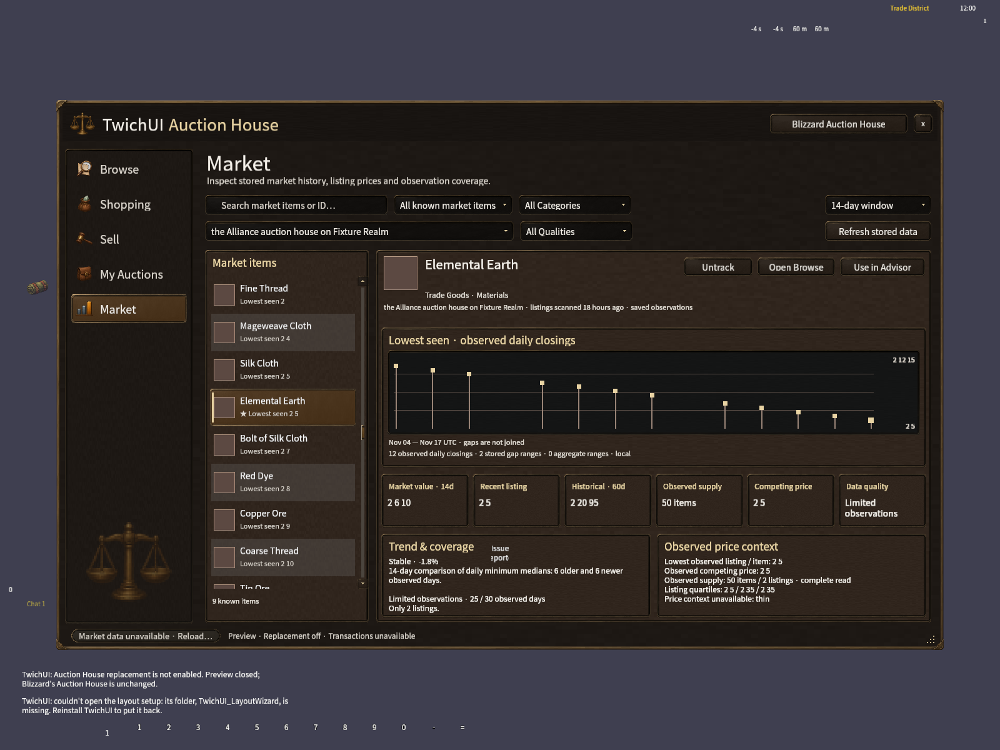
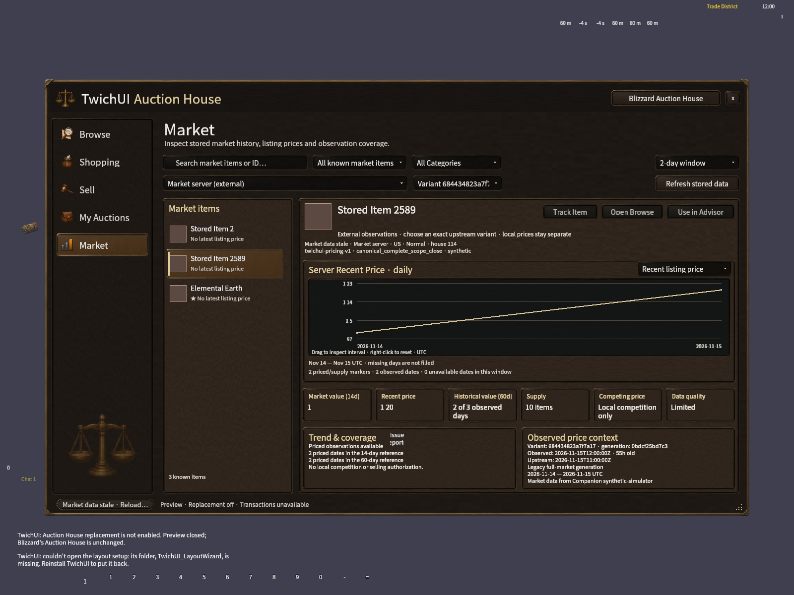
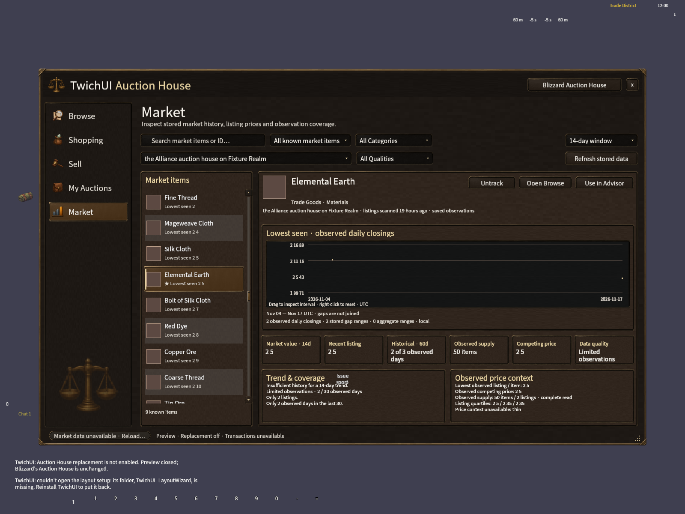
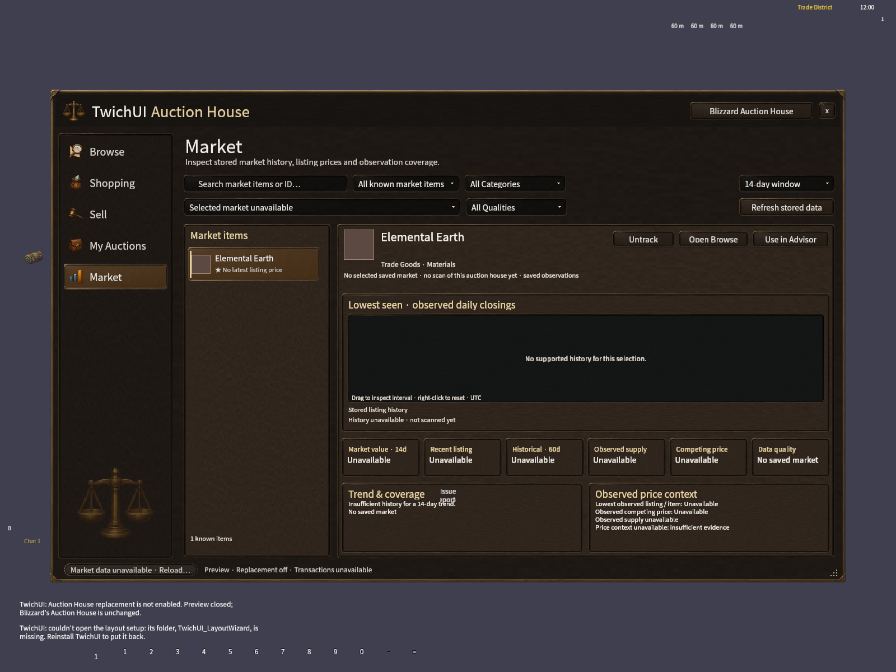
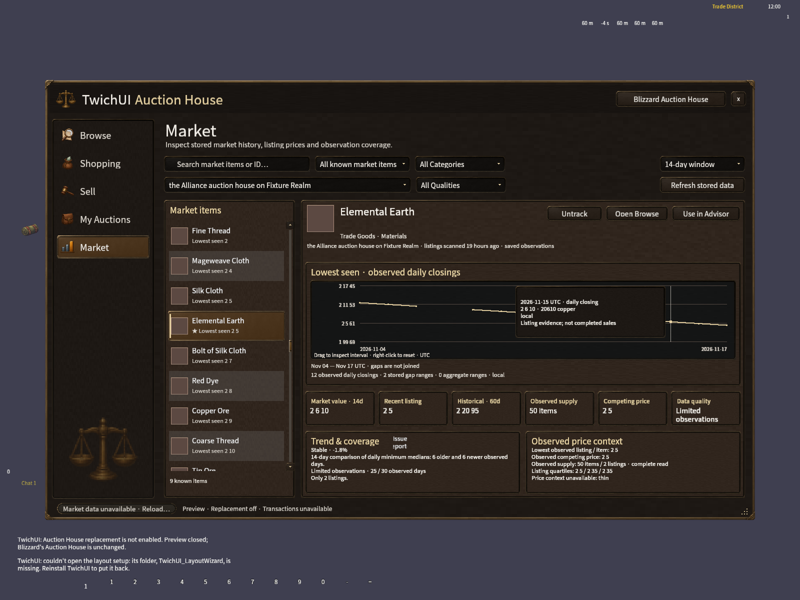
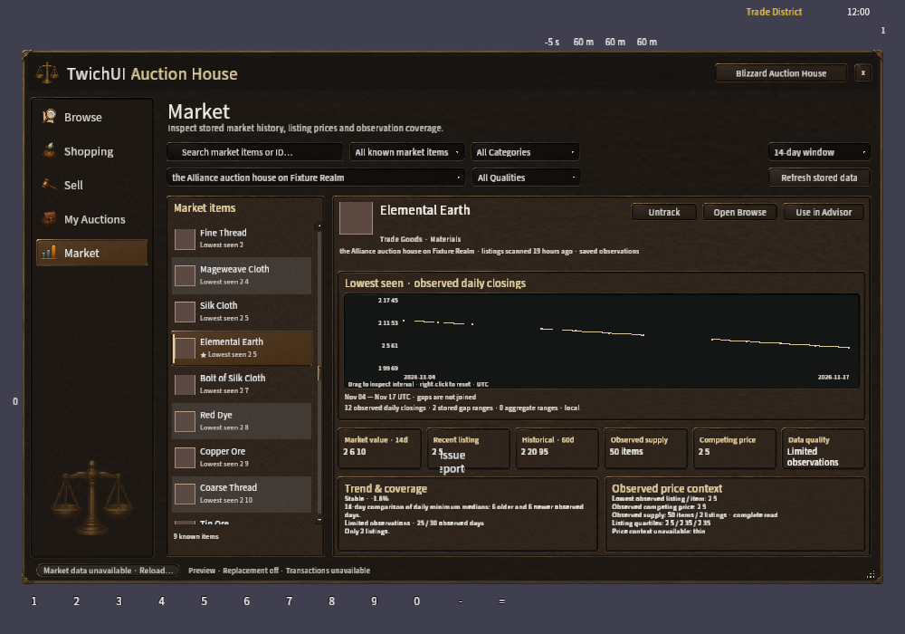
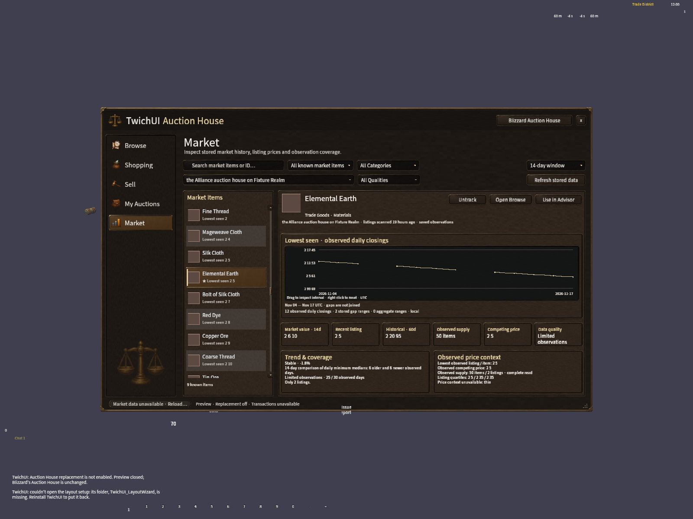
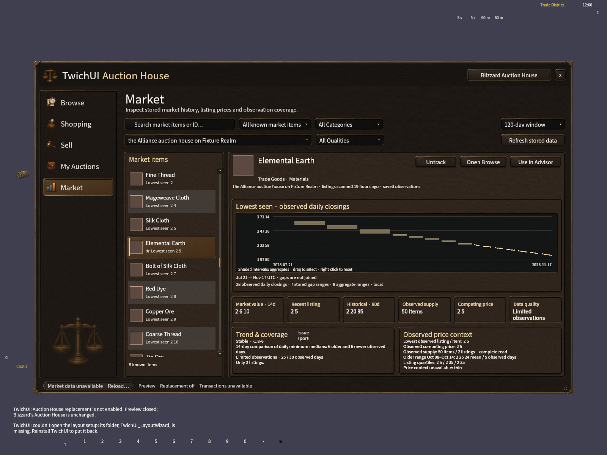
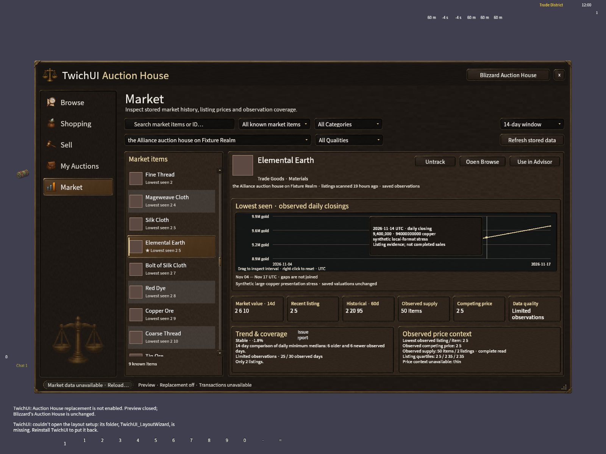

# C1 before/after gallery

[Implementation, measurements and acceptance limits](README.md).
These are unedited simulator captures over synthetic data. Native game fonts, currency
icons and game assets are unavailable; this is structural owner review, not Forever
visual acceptance. Click any image to inspect the original resolution.

## Before / after

| Before — stems and dots | After — segmented price history |
|---|---|
|  |  |

The shell and feature hierarchy remain intact. The chart gains value/date axes,
independent inspection, interval navigation and explicit aggregate geometry.

## Ordinary local history

Fine bronze segments replace the stems; missing days stay open.

## External Market history

Two supported daily listing observations; exact upstream variant remains selected.

## Sparse history

Two isolated markers; the missing period is never joined.

## One observation

One marker and coverage annotation, with no fabricated flat trend.

## Unavailable history

An explicit unavailable state with no invented values or value guides.

## Hover inspection

Crosshair, selected marker, exact copper, UTC date and provenance; panel beside the marker.

## Selected interval

Drag-selected viewport with recalculated axes; right-click restores the full window.

## Narrow screen

1000 × 700 output; inherited shell scaling keeps stroke geometry aligned.

## Alternate UI scale

0.8 UIParent scale, with the same logical chart and evidence.

## 120 days and aggregates

Older ranges are bands, not daily observations; exact days and gaps remain separate.

## Large copper labels

Synthetic 90–97 billion copper stress; axes use explicit compact gold units, hover retains exact copper.

