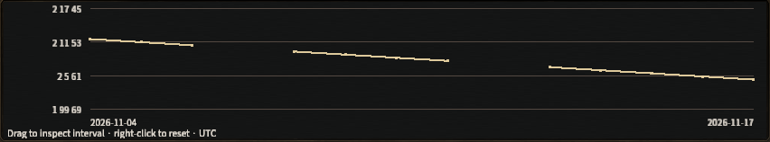
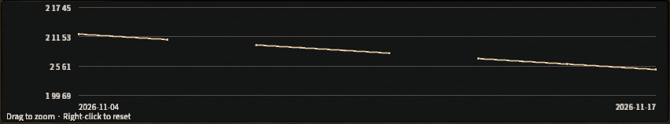
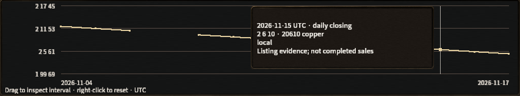
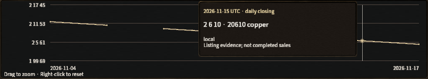
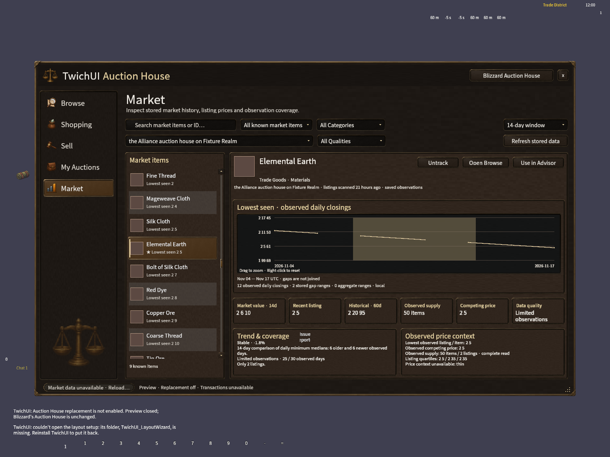
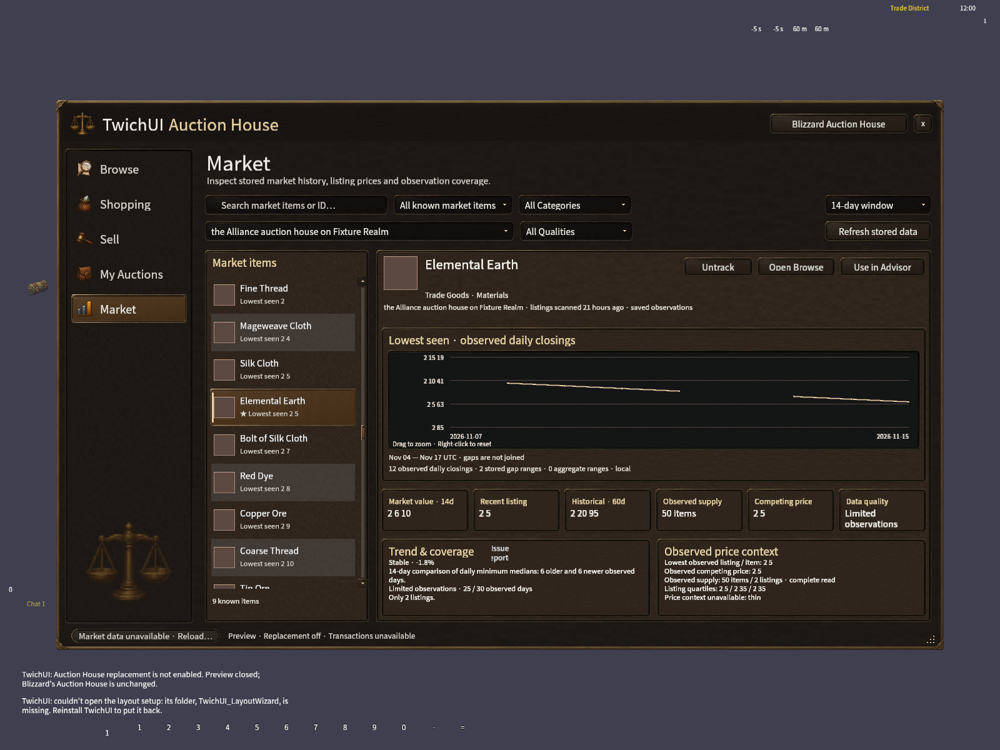
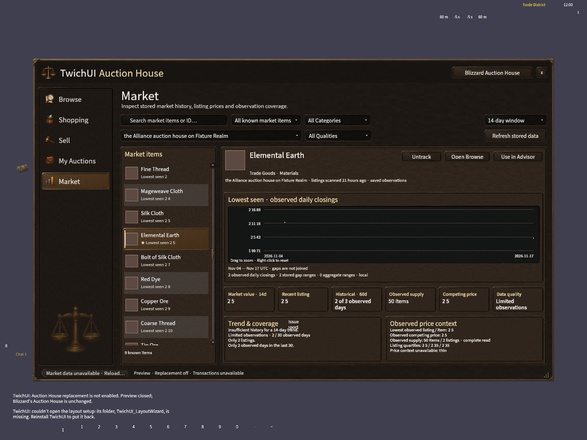
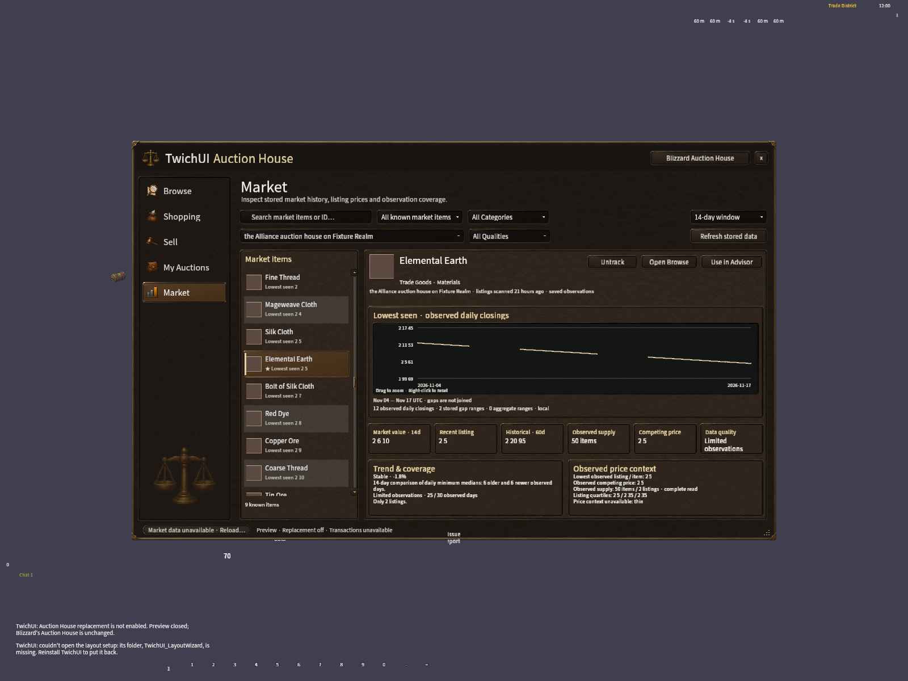
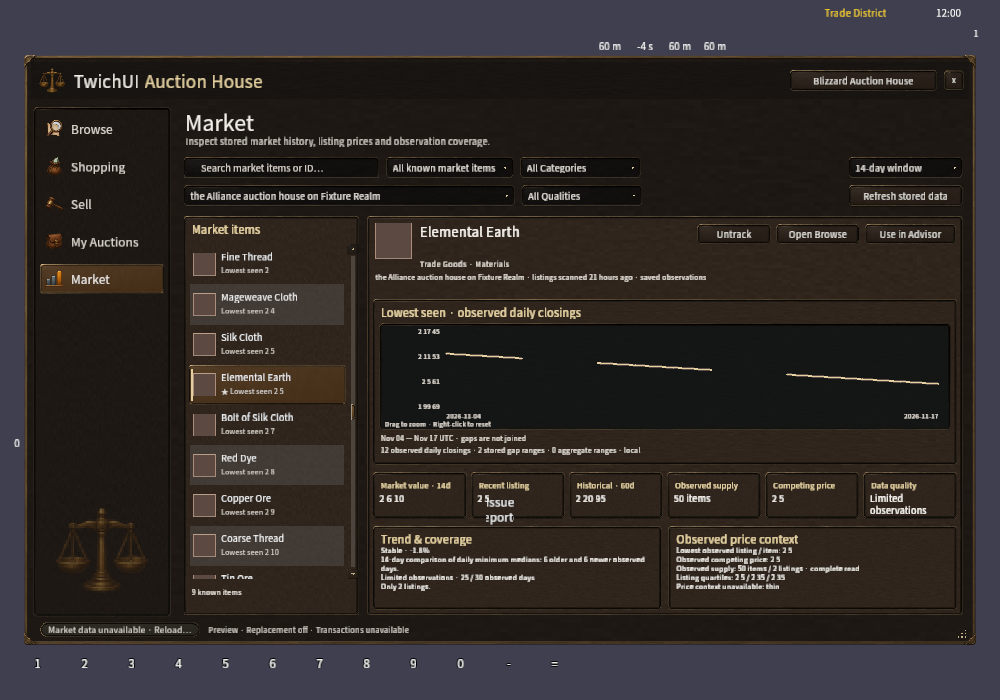
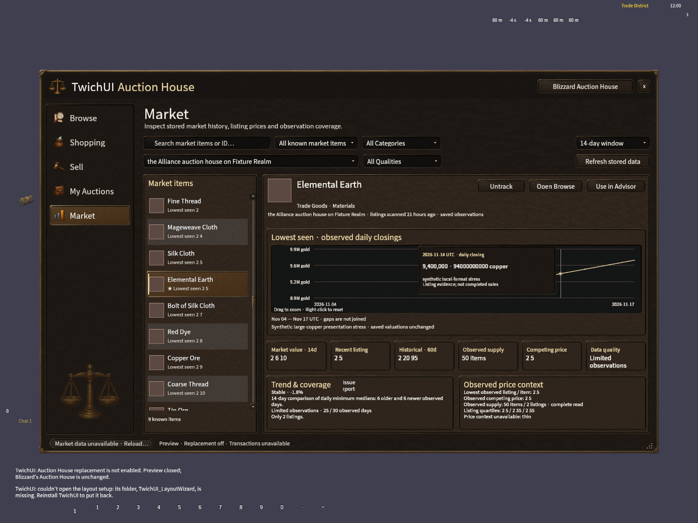

# C1.1 chart review gallery

[Root causes, implementation, measurements and acceptance limits](README.md).
[Original C1 gallery](../GALLERY.md) remains intact. Full screenshots below are unedited
simulator captures using synthetic data. Crops only extract the same rectangle; they
are not resized, recolored, retouched or generated. Native fonts/assets and actual
Forever mouse delivery remain unverified.

## Price stroke: identical 852 × 158 crops

| C1 | C1.1 native candidate |
|---|---|
|  |  |

## Inspection hierarchy: identical crops

| C1 | C1.1 |
|---|---|
|  |  |

Click a capture for its original resolution. Geometry/input checks are modeled, not a
real-client appearance or pointer acceptance claim. The native candidate retains the
C1 raster fallback; the owner should compare both in Forever.

## Ordinary history

Region-anchored core and supporting edge; small round markers; gaps remain open.

## Inspection

Input is reachable over the full plot and beneath the noninteractive panel. Crosshair follows the cursor; marker stays on the sample.

## Drag in progress

A live bronze selection band remains visible without the inspection panel covering it.

## Selected interval

Release zooms the viewport; right-click resets. No values are resampled.

## Sparse evidence

Isolated observations remain isolated; gap inspection never fabricates a price.

## Aggregate ranges

Weekly/fortnightly summaries stay interval bands, separate from exact observations.

## Alternate UI scale

0.8 UIParent scale: zero-offset texture anchors keep native strokes on their markers.

## Narrow layout

1000 × 700 output with the inherited shell fit; chart input and geometry remain aligned.

## Large copper inspection

Compact explicit gold axis units and full exact copper in the inspection panel.

