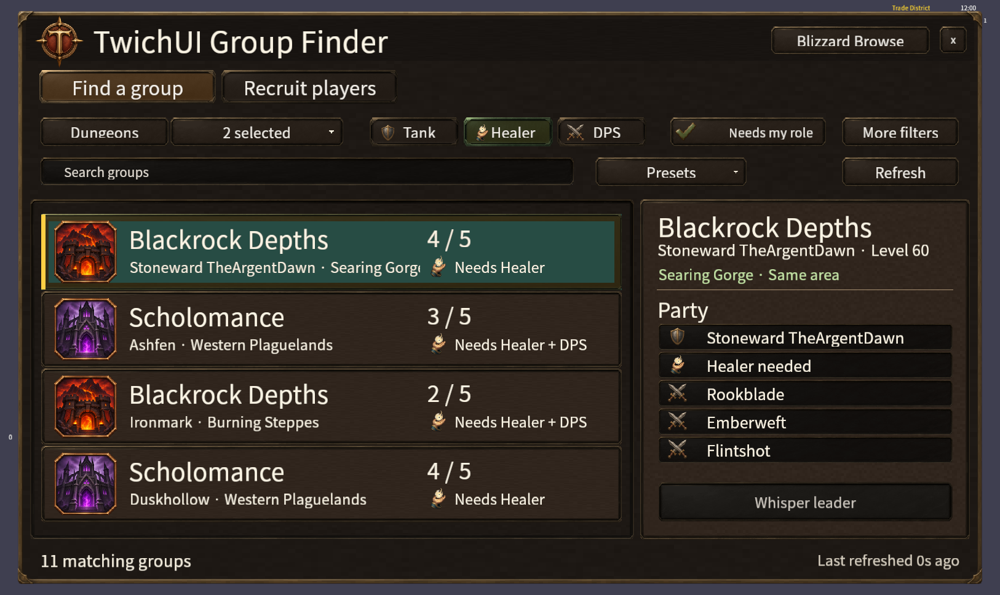
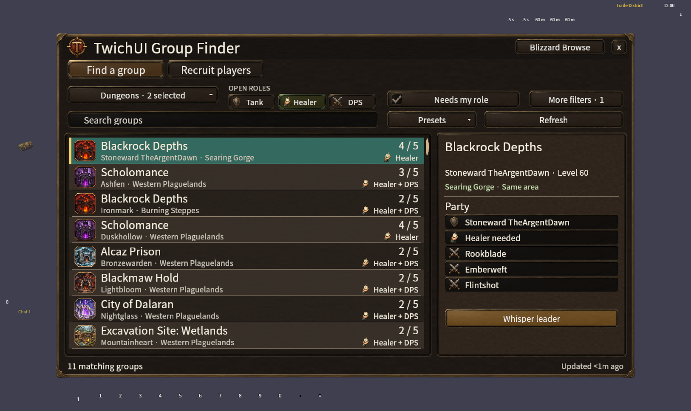
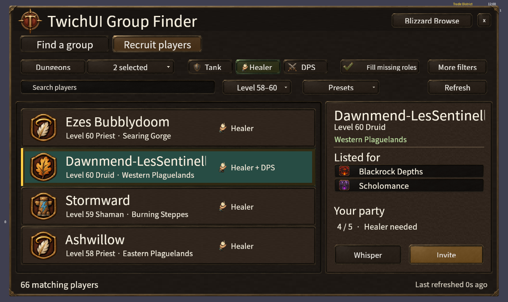
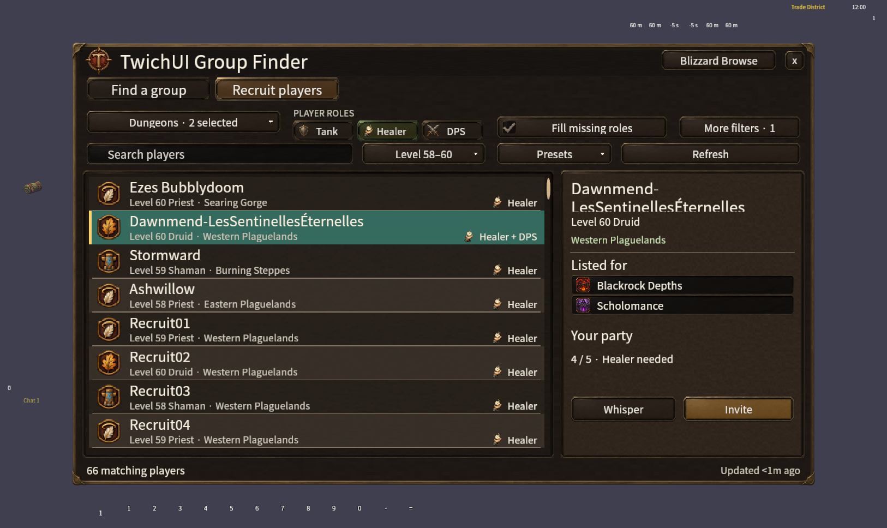
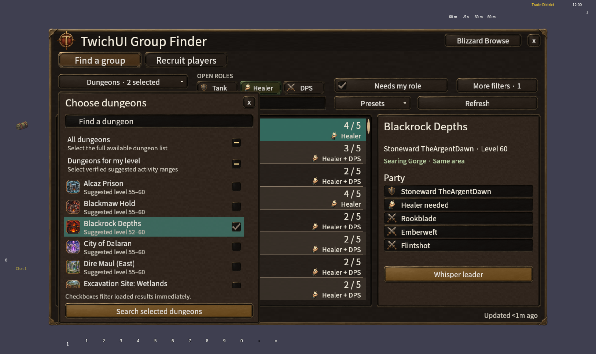
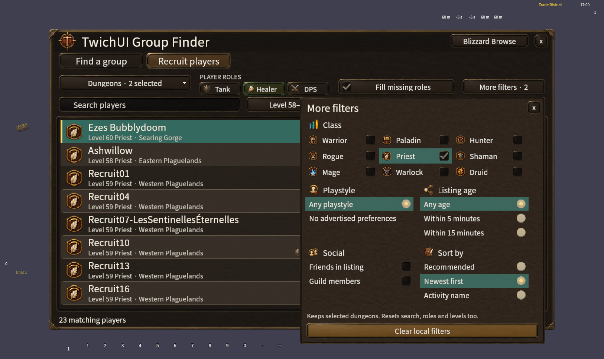
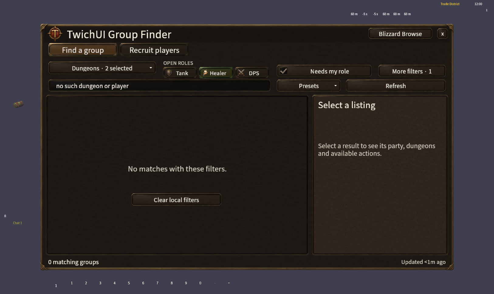
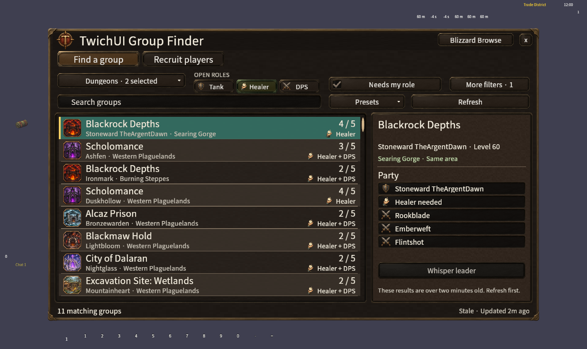
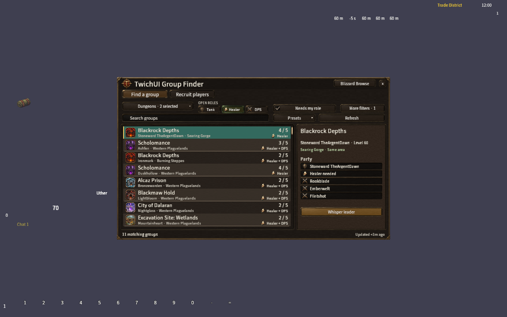

# Group Finder polish review

Reviewed simulator captures for runtime commit `a9d323e2515c97ee624bb5555bac407a545da7b4`.
The before implementation is commit `8c5f2f96`; an immutable staged copy was
preserved before editing. Both sets use identical synthetic records: 11 groups,
66 recruits, long names, multi-role recruits and the new Forever dungeon names.
The owner’s native screenshots informed this pass, but these gallery images are
**simulator captures**, not native-client runs.

| Measurement | Before | After |
| --- | --- | --- |
| Window, UI units | 1060 × 630 | 920 × 548 |
| Window reduction | — | 13.2% narrower, 13.0% shorter |
| Row height, UI units | 85 | 42 |
| Complete rows per tab | 4 | 8 |
| Matched viewport | 1626 × 968 | 1626 × 968 |
| Matched capture scale | 1.48 | 1.48 |

At that scale, the outer frame is approximately 1569 × 932 versus 1362 × 811
pixels, and rows are approximately 126 versus 62 pixels. The small pose uses
1280 × 800 at scale 0.75. Normal scale 1.0 was also checked during development.
Source dimensions, full visible row bounds and popup viewport bounds are checked
by the real-frame simulator fixture.

| Find a group before | Find a group after |
| --- | --- |
|  |  |

| Recruit players before | Recruit players after |
| --- | --- |
|  |  |

| Illustrated picker | Grouped filters |
| --- | --- |
|  |  |

| Filtered empty | Stale results |
| --- | --- |
|  |  |

`./tests/run.sh feature group-finder --profile cloud` passed 13 test modules,
38 Lua syntax checks, load/construction smoke, and seven Group Finder poses
with 512 synthetic handler/state assertions. The before pair passed ten checks
each. The focused controller tests also prove that native full names containing
spaces reach Whisper/Invite unchanged, while invalid identities, markup,
control text, stale results and insufficient invite authority remain blocked.

These checks do not establish actual hardware provenance, server coverage,
taint, real reload persistence or native fonts. The simulator substitutes fonts;
its pictures establish structure and support the visual review. The modified
build has not been run in the live client. See [native acceptance](../../group-finder.md#native-acceptance).

The existing CraftLook frame, crest, class shields and role artwork are reused.
The shared activity lookup now supplies 26 distinct original illustrations at
128/64/32 pixels, with a neutral fallback. This includes Maraudon, Zul’Farrak,
Uldaman and the screenshot-confirmed Alcaz Prison, Blackmaw Hold, City of Dalaran
and Excavation Site: Wetlands. [Artwork provenance](../../../assets/groupfinder-art.md)
records the source sheets and verified map/name mappings.
