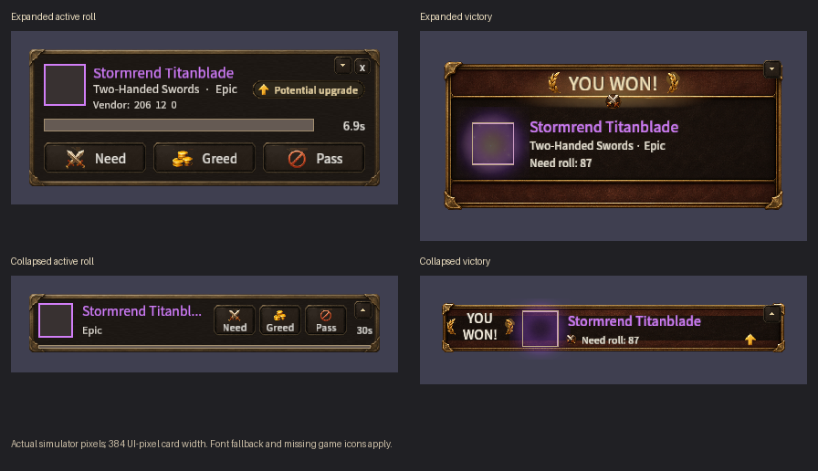
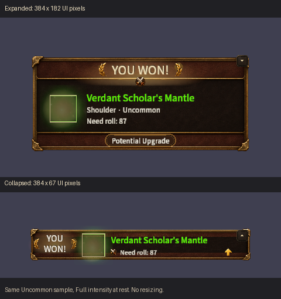
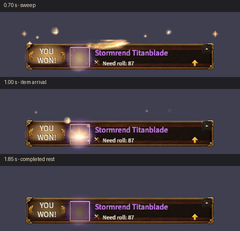

# Compact loot card evidence

These are simulator screenshots of the production renderer over synthetic loot.
They are exact crops or labeled contact sheets, with no resizing or replacement
art. **No native WoW Forever visual verification is claimed.** The simulator uses
Friz Quadrata in place of addon fonts, and the game item icons are unavailable in
these captures. Empty icon interiors are a simulator limitation; the original
icon paths remain unchanged.



The active Mini card is 64 UI pixels high at the existing 384-pixel width; victory
Mini is about 67 versus Expanded victory's 182. Critical manual choices retain
labeled 46×34 targets. The layout follows the approved compact mockups: bronze and
leather, compact item/reward content, clear controls, a thin authoritative timer,
and manual expansion. The 384-pixel width requires earlier name ellipsis than the
larger supplied illustration; the standard item tooltip retains the whole name.

Individual requested captures:

- [Expanded active roll](expanded-active.png)
- [Collapsed active roll](collapsed-active.png)
- [Expanded victory](expanded-victory.png)
- [Collapsed victory](collapsed-victory.png)
- [Roll = No change, Card display = Collapsed](display-only-rule.png)
- [The same rule at a narrower settings size](display-only-rule-narrow.png)
- [Mixed Expanded/Collapsed active and victory stack](mixed-stack.png)



The overview uses Epic items; its expanded victory fixture hides the upgrade
badge, while the Mini fixture shows the compact indicator. The size comparison
above uses the same Uncommon item, upgrade visibility and Full resting pose.



The existing preview was exercised through complete animation playback and
interruptions, as well as paused captures. The Mini uses the supplied gold
lighting, glints, fixed outward particle paths and rarity glow. Effects settle at
1.85 seconds, leaving no decorative updater running at rest.

## Results and reproducibility

- `./tests/run.sh development loot-rolls`: 4/4 modules passed, including the
  extended roll/lifecycle tests, fresh-client persistence and asset contracts.
- `./tests/run.sh feature loot-rolls --profile cloud`: 58/58 modules, 191 Lua
  syntax files passed. Includes core/settings/shared UI dependencies, package
  contracts and diagnostics checks. This is scoped regression, not the complete
  release gate.
- 22 simulator views passed across `loot-hqloKz64`, `loot-qE9MOYNe` and
  `loot-KYXj5NKE`. These cover the six requested states, narrow builder, Mini
  Need/Greed, Uncommon/Rare/Epic/Legendary, Off/Subtle/Full, long names,
  upgrade shown/hidden, and 75% scale. The earlier `loot-9hRBsScv` run also covered
  Mini automatic controls and manual toggles.
- Full animation captures at 0.40, 0.70, 1.00 and 1.85 seconds have **zero changed
  pixels outside the new 20×20 toggle** versus the pre-feature Full captures.
  The expanded static Epic card also differs only at the toggle. This comparison
  uses identical simulator fixtures, not a native pixel baseline.
- No runtime art, sounds, packaging exclusions, TOCs or settings migrations were
  changed. The supplied frame is resliced for Mini; existing rarity/FX files are
  reused. `verification.json` records source hashes, crop coordinates and the
  full-motion comparison masks.

Example commands (from the repository root, with the documented lab environment):

```sh
bash tools/simlab/run.sh loot manual miniActive miniAuto compactMixed compactRule compactRuleNarrow
bash tools/simlab/run.sh loot victoryStatic victoryPoseMiniFull040 victoryPoseMiniEpicFull070 victoryPoseMiniEpicFull100 victoryPoseMiniEpicFull185
bash tools/simlab/run.sh loot victoryPoseMiniGreedRareSubtle100 victoryPoseMiniLegendaryFull185 victoryPoseMiniLongNoUpgradeOff185 victoryPoseMiniEpicFullScaled100
```

Raw screenshots/logs remain under ignored `test-output/simlab/artifacts/`.
The known simulator voice-settings boundary warning was classified by the existing
runner; no unknown/unexpected Lua errors passed classification.

Native follow-up: check the real addon fonts and long localized names at ordinary
UI scale; item textures and alpha on the actual driver; real Need/Greed/Pass,
confirmation and combat behavior; late/identical drops and fast mixed-stack reflow.
Simulator stubs do not prove secure-input behavior, audio, FPS, server event timing,
or coexistence with third-party alert replacements.
