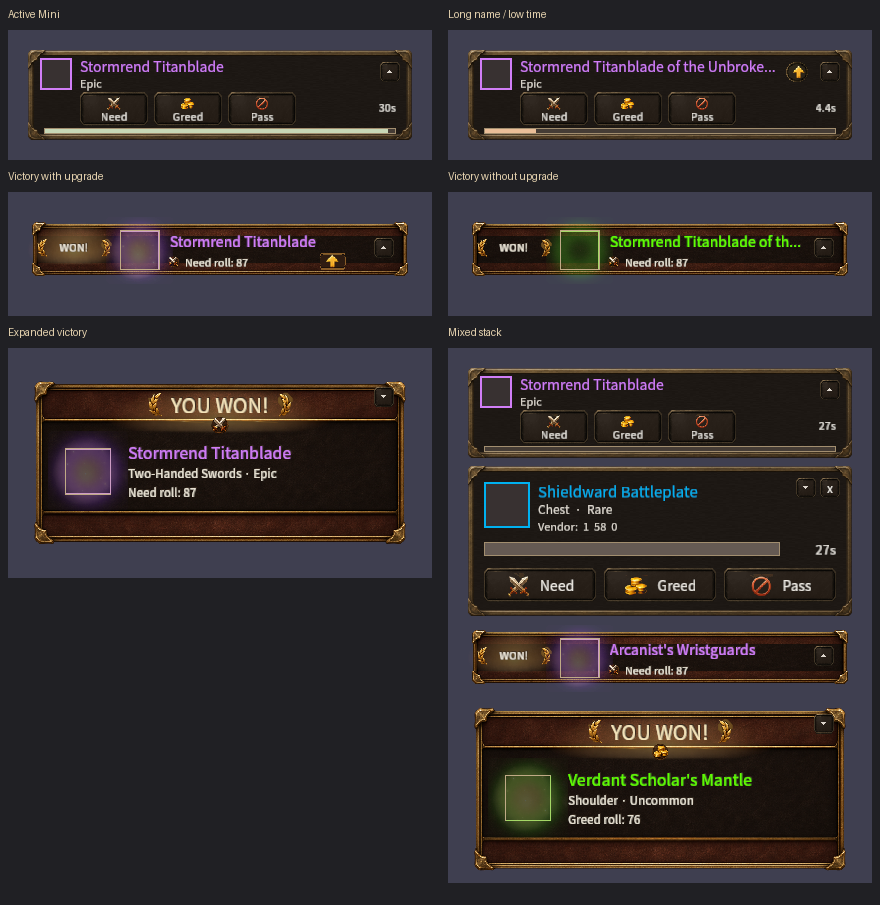

# Compact card layout refinement

Actual pixel crops from the simulator; addon fonts are substituted and game item icons are unavailable. The top two rows show current Mini active and victory layouts; the bottom row shows an expanded victory and mixed stack. The active Mini card is 384×90 UI pixels, previously 384×64; Mini victory remains approximately 384×67. The long-name capture is at approximately 4.4 seconds remaining and shows the shortened timer fill.

Simulator scenarios `miniLong80`, `miniLong120`, `miniLong`, `victoryPoseMiniEpicScale80Full185`, `victoryPoseMiniEpicScale120Full185`, `victoryPoseMiniLongNoUpgradeOff185`, `compactMixed`, and `victoryStatic` passed. Subsequent final-fill captures `miniLong`, `miniActive`, and `victoryPoseMiniEpicFull185` passed. 80% and 120% captures exercise simulator card scaling, not native text metrics.

Native verification remains necessary for the real font, full item textures, readable controls and tooltip hit areas at 80%, 100%, and 120%, live countdown and expiration, and animation during mixed-stack reflow.
