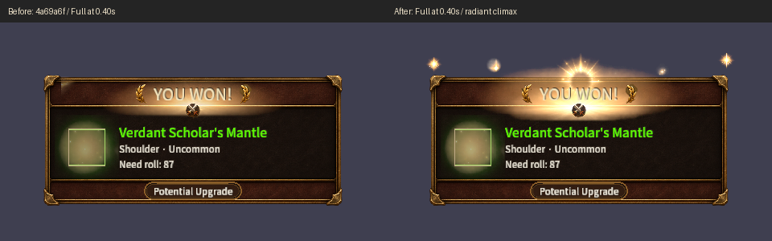
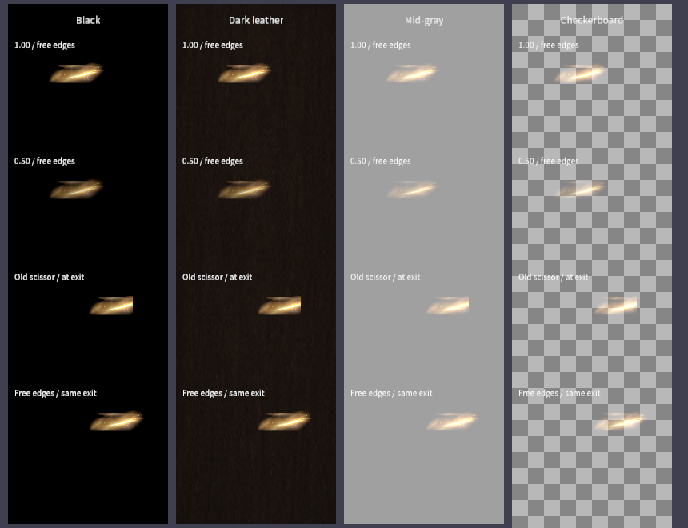
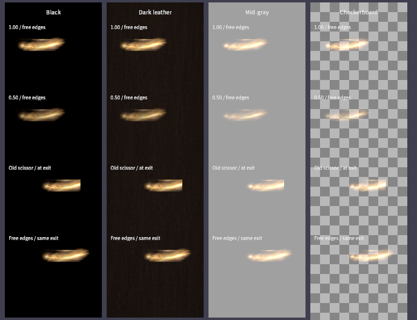
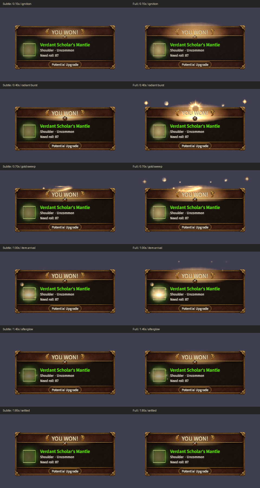
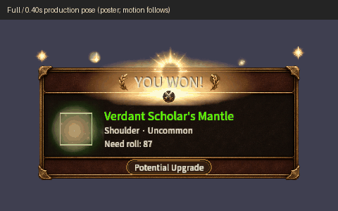
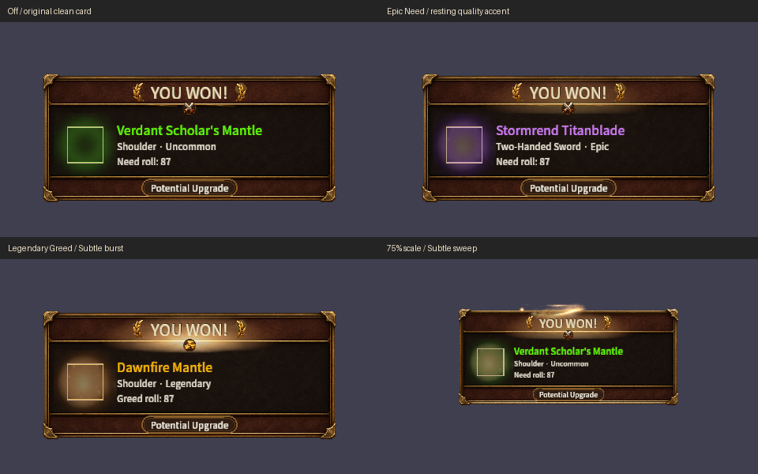

# Loot Victory celebratory FX overhaul

The approved card layout is unchanged. This pass adds a coordinated radiant peak,
a feathered sweep, stronger item arrival and controlled overflow to the existing
painter/pool. **No native WoW Forever visual acceptance is claimed.**

Exact simulator crops at the existing 384-pixel displayed card width. The prior
side is commit `4a69a6f`, with the same sample, scale and font fallback. Captures
include extra margin to show effects escaping above the frame. Nothing is enlarged,
retouched or generated. The reward's item/name/quality/roll/badge geometry is intact.

## Sweep root cause and correction

The supplied sweep exports have clean alpha: transparent canvas borders, zero RGB
where alpha is zero, and sampled content borders at most 1/255 alpha. PNG/TGA decode
agrees. There was no source contamination or premultiplication repair to perform.

The old 392×46 child-clipping viewport cut off the visible feather as the sweep
exited its right edge. The isolated test reproduces that hard vertical boundary
at unchanged brightness; disabling the scissor restores the natural fade.

Columns: black, dark leather, mid-gray and checkerboard. Rows: full alpha, half
alpha, old clipped exit, and the same exit without clipping. This is simulator
rendering of the actual runtime files at gameplay size, not an illustrative blend.

Production no longer scissors the sweep. Its center stays on the bronze header,
while the complete haze/core/tail transparency can fade naturally. Opacity was not
lowered to conceal the defect. Only supplied art is used. Native-driver behavior
still needs review; the newly mentioned native artifact screenshot was not attached
to this turn, so this diagnosis is grounded in the reproduced code path and lab.

## Choreography and modes

- **0–0.20 s, ignition:** header haze expands slightly and the emblem awakens.
- **0.20–0.60 s, radiant burst:** Full aligns a 1.00 title bloom, 0.80 emblem glow,
  0.95 radial bloom and three prominent stars around 0.38–0.40 s. Eight particles
  overlap by 0.55 s. Subtle has a much quieter 0.38 title bloom and no radial burst.
- **0.45–0.95 s, sweep:** one haze/core/tail follows a smooth path across bronze.
  Full uses core/haze/tail alpha 1.00/0.60/0.65 and two trim glints;
  Subtle uses 0.75/0.28/0.20.
- **0.75–1.40 s, item arrival:** icon bloom peaks at 0.85 Full or 0.35 Subtle,
  with a sharp frame glint and the actual quality ring's brief secondary rise.
- **1.40–1.85 s, afterglow:** all bright effects and particles disappear; the broad
  haze contracts inside the header. Rest has only soft local atmosphere.

Full has twelve fixed particle paths: prominent final-star glints, medium stars/
twinkles and smaller motes, with staggered eased/arched travel. Subtle uses four
quiet paths. A few Full effects extend roughly 15–30 UI pixels beyond the frame.
No effect captures input. Text and item artwork are explicitly above all lighting.
The original chime at 0.30 s now reinforces the burst; no audio files changed.

Original 3.5/4/5-second completed-card hold choices and the 0.30-second exit remain.
The new reveal ends at 1.85 s, making Normal's total 6.15 s. Off retains the original
clean card and runs no supplemental FX or animation updater.

## Gray preview finding and repair

The previous GIF's first frame was the intentionally transparent 0.00-second pose.
Static-only GIF viewers therefore showed only gray. Later real rendered poses and
clock-driven previews worked; assets were not failing to load. Time zero still
correctly has no residual effects and is tested separately.

The exports now start with a visible actual production-pose poster. Motion starts
at 0.10 s and ends in completed rest, omitting the intentionally empty endpoints.
Each timestamp is labeled. No native image or generated in-between frame is used.

[Short MP4 preview](victory-celebration.mp4) · [Static poster](poster.png)

The GIF repeats for review. The MP4 contains only active motion and completed hold.
Poses are sampled mostly every 100 ms, with selected 50 ms checkpoints; repeated
frames preserve those intervals. MP4 encoding at 20 fps adds no interpolated motion.
This is an offline review aid, not a recording of native gameplay or native FPS.

## Assets, performance and verification

Thirteen TGAs ship under `!!!TwichUI/media/loot/victory/fx/`: the eleven core files
plus supplied `fx_sweep_trail.tga` and `fx_emblem_final_star.tga`. All are byte-identical
to the manifest. No unused alternatives or source atlases ship. Selected PNGs and
manifest/docs stay under excluded `assets/loot-victory-fx/`.

The existing update/timer/pool architecture remains. Twelve slots replace six,
with one pooled radial copy, a tail and two trim-glint textures. There are no new
UI objects per playback or per-frame particle allocations. Updates stop at 1.85 s;
hide, disable, interruption and replay keep existing cleanup. Native FPS, combat
and taint are not established by the simulator.

- **Unit-tested:** four focused modules pass. Asset checksum/format/canvas and
  sampled-UV edges; timing, layering, unscissored overflow, twelve-slot bounds,
  Subtle/Full differentiation, all roll/quality/intensity variants, replay reset,
  sound, queue, duplicate/native fallback and existing loot/rule checks pass.
- **Affected regression selection:** 58/58 modules and 191 Lua syntax checks pass
  on unchanged source. This is scoped feature coverage, not release certification.
- **Simulator-tested:** 40 final isolation/pose/settings/replay/lifecycle views pass.
  The first batch caught an old 1.80-second Settings fixture wait, before the new
  1.85-second endpoint. That wait now uses MOTION_END + 0.05, and the targeted
  Settings rerun passes; the other 39 cases passed without addon changes.
  Actual-clock replay/stop/timeout checks cover updater and timer cleanup.
- **Screenshot-reviewed:** isolated full/half-alpha backgrounds, complete sampled
  Full sequence, all six Subtle checkpoints, resting state, Off and 75% scale.
  Source/capture identities and measured hold differences are in [verification.json](verification.json).

The lab cannot load actual item icons and substitutes its font for addon fonts.
Underlight visible in the empty icon would be occluded by a real item texture.
Native font contrast at peak, true item/glow balance, alpha sampling/blending,
perceived rhythm, audio, real wins and suppression, combat/taint and reload still
need in-game review. Use the [existing native checklist](../../loot-victory.md#owner-directed-in-game-checks).
