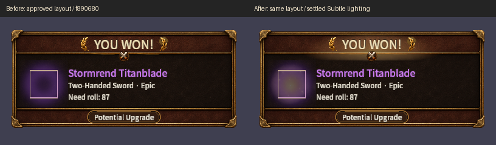
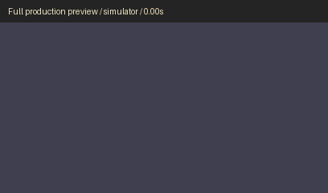
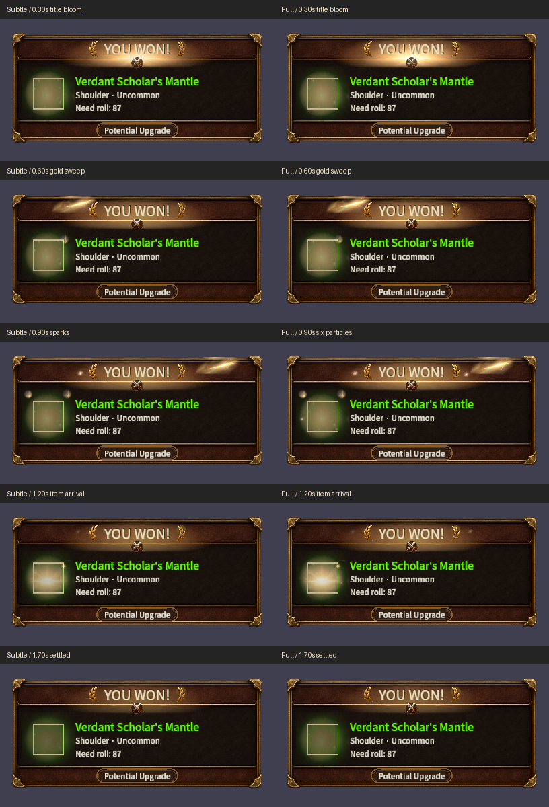
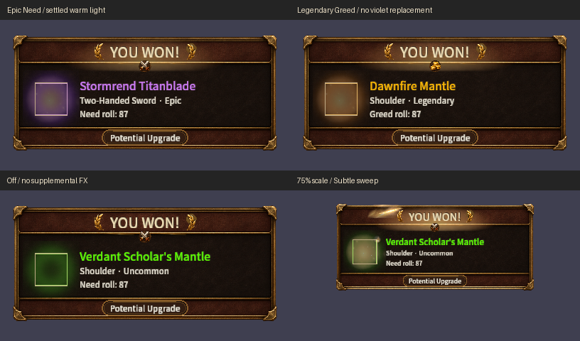

# Loot Victory supplemental gold lighting

This pass preserves the approved layout from `f890680` and integrates eleven
individual textures from TwichUI Victory FX Supplement v1 into the existing
production painter, pool and lifecycle. **No native WoW Forever testing occurred.**

Exact simulator crops at the same 384-pixel card width and font fallback. No
resizing, retouching, generated light or substituted item icons. The difference
is local golden illumination behind the existing heading and item. Card geometry,
rarity presentation, upgrade state and interactions are unchanged.

## Production preview

Full mode uses actual rendered poses at 100 ms intervals through 1.70 seconds,
then samples the unchanged hold and exit. No generated/interpolated frames. The
GIF repeats for review; runtime playback is once. The same V.Paint renders live
results, previews and these paused poses. Separate clock-driven cases verify that
updates advance, stop, complete and cancel on interruption.

Atmosphere rises over 0–0.25 s. Title bloom peaks at 0.30 s, followed by a paired
haze/core sweep over 0.38–1.05 s. Three Subtle or six Full particles drift on fixed
paths over 0.55–1.35 s. Item bloom/glint punctuate 0.90–1.50 s. By 1.65 s only soft
residual haze remains, with no OnUpdate. The original 1.75 s hold budget and
6.05 s Normal total lifetime are preserved, as are sounds and sound settings.

Subtle/Full peak alpha: header haze 0.35/0.42, icon haze 0.30/0.36, title bloom
0.62/0.75, sweep core 0.90/1.00, sweep haze 0.35/0.45, icon bloom 0.42/0.62.
Full adds a 0.55 emblem burst and three additional particles. Settled header haze
is 0.16/0.18 and icon haze 0.12/0.15. Off hides all supplemental effects.

## Asset fidelity and layers

Only the eleven core TGAs ship under `!!!TwichUI/media/loot/victory/fx/`:
header/icon haze, header/emblem/icon bloom, sweep haze/core, small glint, star,
twinkle and medium mote. The optional violet ring and other alternatives are
omitted. See the [exact file list and layer table](../../loot-victory.md#artwork-and-animation).
Five superseded original runtime effects were removed. Original sounds remain.

Each selected TGA is checksum-identical to the supplied manifest, with verified
32-bit alpha, power-of-two dimensions, transparent borders and PNG/TGA decoded
pixel equivalence. Manifest UVs trim padding. The medium mote retains empty space
inside its generic manifest rectangle; measured alpha bounds plus a two-pixel
transparent margin correct its sampling without changing the file.

Rear to front: original leather/bronze base; additive atmosphere/blooms and clipped
sweep at level +1; original title, icon, borders and text at +2; small particles
and item-frame glint at +4. The sweep canvas explicitly stays below the title.
No vertex tint touches item icons. New frames inherit card strata and disable
mouse input. Authoring PNGs, manifest/docs and reference previews are retained
under `assets/loot-victory-fx/`, excluded from packaging; no atlas is displayed.

## Verification and limits

- **Unit-tested:** four focused modules pass. Includes checksum/format/alpha and
  runtime subset checks; layer/UV/path contracts; exact stage timing; all
  Need/Greed × four rarity × Off/Subtle/Full combinations; long names/tooltips;
  upgrade visibility; quick interruptions and pool reuse; immediate Off cleanup;
  sound behavior, lifecycle and existing loot/native fallback regressions.
- **Affected regression selection:** 58/58 modules and 191 Lua syntax checks pass
  on unchanged source (`feature loot-rolls --profile cloud`). No full release
  certification is implied.
- **Simulator-tested:** 34 final pose/settings/replay/lifecycle views pass. Rapid
  replay clears all particle slots and blooms, reaches rest without an updater,
  reuses the same pool and cancels its hold timer when stopped.
- **Screenshot-reviewed:** the complete sampled Full sequence, five matching
  Subtle checkpoints, Epic Need, Legendary Greed, Off and 75% scale. The two hold captures differ only at five item-name edge pixels (at most
  2/255 per channel); every region outside the item name is identical. The final
  exit matches the empty start. Source/capture
  identities are in [verification.json](verification.json).

Game icons are unavailable and addon fonts fall back in the lab. The empty icon
allows light that a native item texture would occlude to show through in these
captures. They do not prove native item/glow balance, exact font clearance, alpha
sampling, blending, perceived animation rhythm, audio, combat/taint, real events
or reload persistence. Compare in-client at normal scale using the existing
Settings preview; especially check title bloom contrast, the white-gold sweep,
item-edge glow, clean alpha edges, Off, rapid replay and native win suppression.
