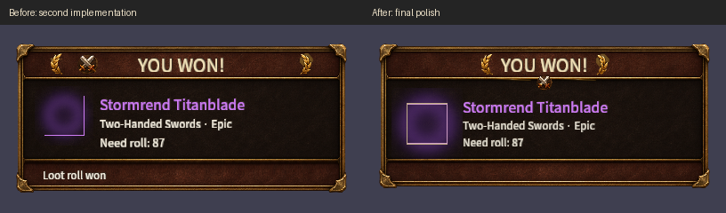
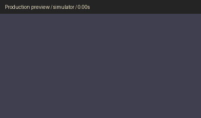
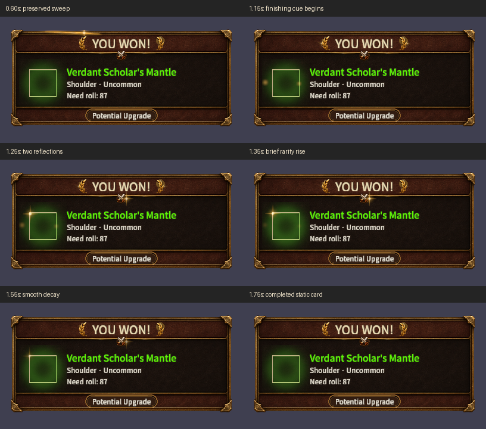
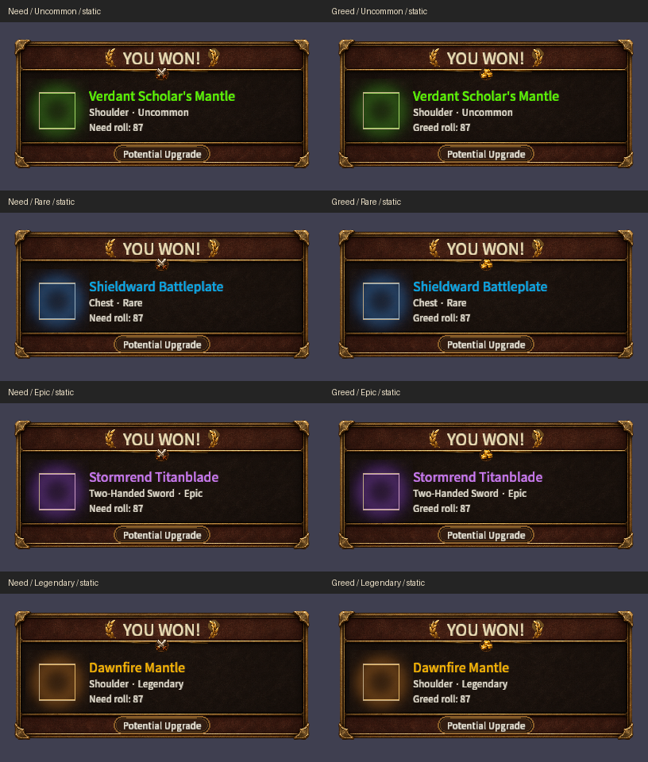
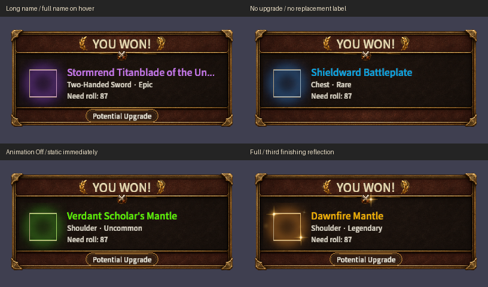

# Loot Victory final polish

Targeted refinement of the second implementation (`df65484`). Existing reveal,
rail sweep, result handling, settings and queue ownership remain intact.
**No WoW Forever native-client verification was performed.**

Both sides are exact simulator crops of the same Epic Need result, at the same
384-pixel card width and font fallback. No screenshot was enlarged or retouched.
The card is now five display pixels shorter. The centered title has tightly paired
laurels, a smaller medallion attached to the lower divider, and two restrained
painted highlights. The icon centers on the three item lines, its frame mixes
bronze with the quality color, and secondary text shares a size/color. The footer
contains only the conditional, centered Potential Upgrade indicator.

## Coordinated finishing cue

Actual production-preview renders, sampled at 150 ms during the preserved reveal
and sweep, then 100 ms through the finishing cue, with the configured static hold
and exit. No generated or interpolated frames. The GIF repeats for review;
runtime playback is once. Seeking uses the existing preview painter, not an
independent animation model. Clock-driven tests separately exercise playback,
shutdown, hold, exit and replay.

The 1.15–1.70 s accent reuses the existing pooled sprites: two bright reflections
in Subtle, three in Full, with a delayed rarity-glow rise at 1.24–1.70 s. Travel is
only a few pixels, with eased attack/decay. All accents disappear before the
existing 1.75 s static hold. The reveal, sweep, sound cue and total lifetime keep
their existing timing. No bouncing, spinning, continuous pulsing or new particle
pool was introduced.

## Variants and artwork

Long names receive a measured ellipsis without splitting UTF-8 characters; the
complete name remains in the normal item tooltip. Upgrade state and its existing
setting control the badge, with no replacement label or inventory claim.

All 16 TGAs and both OGGs are byte-identical to the supplied ZIP. Laurel crops
remove asymmetric transparent padding. The halo's 12..244 crop and 96-pixel canvas
move its painted peak outside the 52-pixel icon instead of hiding it underneath.
Its resting alpha is 0.42; the single finishing rise adds at most 0.16. Cropping
the badge's transparent vertical padding gives its larger label room in the
shorter band. Static artwork uses straight-alpha BLEND; only moving light uses
ADD. Painted frame corners retain their scale. No supplied artwork was replaced.

## Verification

- **Unit-tested:** four focused modules passed. Sequential previews covered both
  roll types × four qualities × Off/Subtle/Full, alternating upgrade state, long
  names, complete tooltip names, UTF-8 boundaries, setting visibility, idle
  shutdown and frame reuse. Existing roll/rule/native fallback regressions pass.
- **Affected regression suite:** `tests/run.sh feature loot-rolls --profile cloud`
  passed 58/58 modules and 191 Lua syntax checks on unchanged source. This is the
  scoped feature/dependency selection, not full release certification.
- **Simulator-tested:** 32 final pose/lifecycle/settings views plus the final
  long-name capture passed. Both roll types/all rarities, absent upgrade, Off,
  Full, 75% scale, real clock completion and repeated Settings previews were
  exercised using synthetic game data and the actual renderer.
- **Screenshot-reviewed:** before/after, all eight static rarity/choice pairs,
  finishing stages, long-name cutoff, absent badge, Off, Full and 75% layout.
  Source/capture hashes and scenario results are retained in [verification.json](verification.json).

Game icons are unavailable in this lab and addon fonts fall back. These captures
check structure, bounds and state, not native typography, blending fidelity,
perceived animation rhythm or audio. Native wins/suppression, combat/taint and
reload persistence remain unverified here. See the [owner-directed checklist](../../loot-victory.md#owner-directed-in-game-checks).
