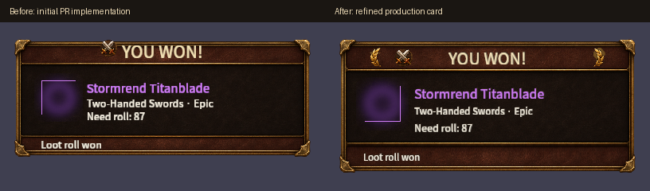
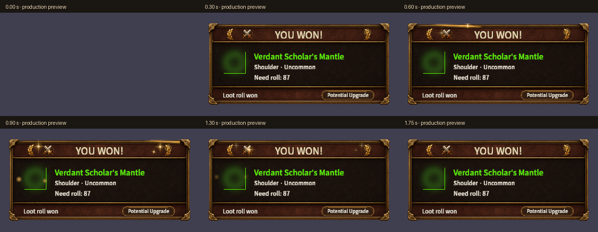
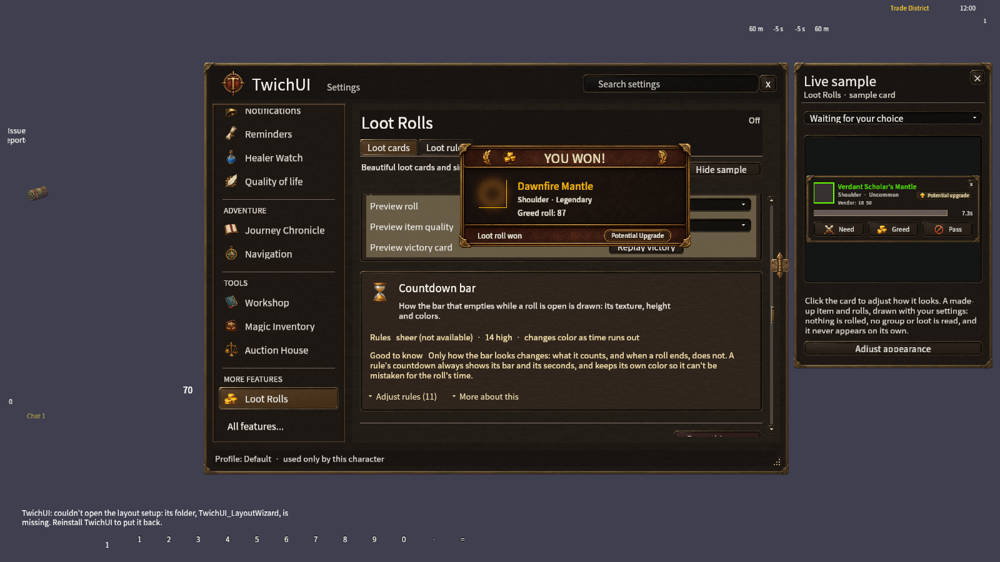

# Loot Victory visual refinement

The owner-provided native screenshot showed the title intersecting the upper rail,
a Greed emblem crowding the title, and a cramped preview footer. This pass uses
the supplied artwork and approved reference to correct that composition and make
the one-shot motion visible. **We did not run or capture WoW Forever.**

## Before and after

Same Epic Need result, same 384-pixel displayed card width, same simulator/font
fallback. Exact screenshot crops; no rescaling, retouching, or generated artwork.
The retained “before” is from initial implementation commit `9617b5c`.

The frame is now sliced into 15 pieces: painted corners stay fixed while the
header/footer leather gets room. The centered title has an explicit 204×30 box at
y24, a dark shadow, and an independent emblem. Both supplied laurels are visible.
The item lines and footer badge have dedicated height. “Sample victory” is removed
from the card; the preview interface identifies the sample. Old roll text hides
before the new banner reveals, avoiding a text ghost during the material fade.

## Motion capture

This is a **20 Hz sampled simulator preview**, assembled from 44 actual rendered
poses (42 encoded GIF frames after identical holds merge). No interpolated frames.
It includes reveal, flourish, burst, finishing reflection, four-second completed
hold, and exit. The GIF repeats for review; runtime notifications play once.
The production preview's `PreviewAt` helper pauses the same V.Paint renderer used
by the real OnUpdate path. Separate clock-driven tests verify that the updater
actually advances and stops, timers expire, queues drain and replay resets.

The retained identity file records source/capture hashes. The shared painter and artwork-building
code are byte-identical between the captured revision and delivered
code. Later fixes only removed inherited preview tooltip metadata, made Off-mode
seeking match instant exit, and hid old live-roll text before crossfade; targeted
settings/static/off/live-reveal captures were repeated afterward.

## Measurable visibility checks

Metrics use unquantized, 1:1 screenshot pixels at 100% card scale, compared with
the settled 1.75-second card. A changed pixel has a maximum RGB-channel difference
of at least 24/255. Bright-core checks use 80/255. These are simulator measurements,
not guarantees about native rendering or monitor appearance.

| Check | Acceptance target | Measured |
|---|---|---|
| Flourish at 0.60 s | ≥80 changed rail pixels, ≥4 bright-core pixels | 539 / 191 |
| Burst at 0.90 s, excluding rail | ≥100 changed pixels, ≥15 bright-core pixels | 508 / 182 |
| Effects over reserved title or item text at 0.90 s | 0 changes ≥5/255 | 0 / 0 |
| Principal star painted core at normal card scale | 8–12 UI pixels | about 9×10 |
| 1.75 s versus hold at 3.75 s | Identical card pixels | Identical |
| End at 6.05 s versus empty start | Identical background pixels | Identical |

The old sweep's painted band shrank to about one display pixel. Its small star's
high-alpha core shrank to about two display pixels, then lost opacity through a
second fade multiplier. The revision uses transparent-padding UV crops, preserved
painted proportions, a truly clipped 11-pixel ribbon, bright core/short tail,
six/eight authored particles and a finishing star. It changes size, composition,
contrast and timing rather than flashing the whole card.

## Verification and limits

- **Unit-tested:** four focused modules passed, including geometry/UV/blend/clip
  contracts, real clock transitions, hold/exit, six/eight sprite visibility,
  replay reset, sound timing, quality-consistent preview data, Off mode and the
  existing roll/rule/queue/suppression regressions.
- **Simulator-tested:** 53 captured poses/lifecycle/settings cases passed. Final
  targeted live reveal/static/Off/settings checks passed; selectors were clicked
  through the real UI to choose Greed and Legendary, with matching sample tooltip
  metadata. Existing general behavior and controls remain synthetic boundaries.
- **Broader dependency suite:** `tests/run.sh feature loot-rolls --profile cloud`
  passed all 58 modules and 191 Lua syntax checks on frozen source. This is the
  relevant Settings/core/loot regression selection, not a full release gate.
- **Screenshot-reviewed:** normal-scale stages, before/after, Full's extra accents,
  75% burst, Greed/Legendary static state and the settings preview.

Game item icons are unavailable in this lab; addon fonts fall back to a game font.
The empty icon in these captures is a simulator limitation. No new image here is
a native screenshot or proof of native typography, alpha/clipping, audio playback,
combat/taint, real win events, suppression, or reload persistence.

Use [the native checklist](../../loot-victory.md#owner-directed-in-game-checks),
especially real-font header clearance, emblem gap, footer readability, apparent
sweep/burst visibility at normal/75% scale, single sound at 0.30 s and the fully
static hold after 1.75 s. Test both roll types and all four quality selections.

