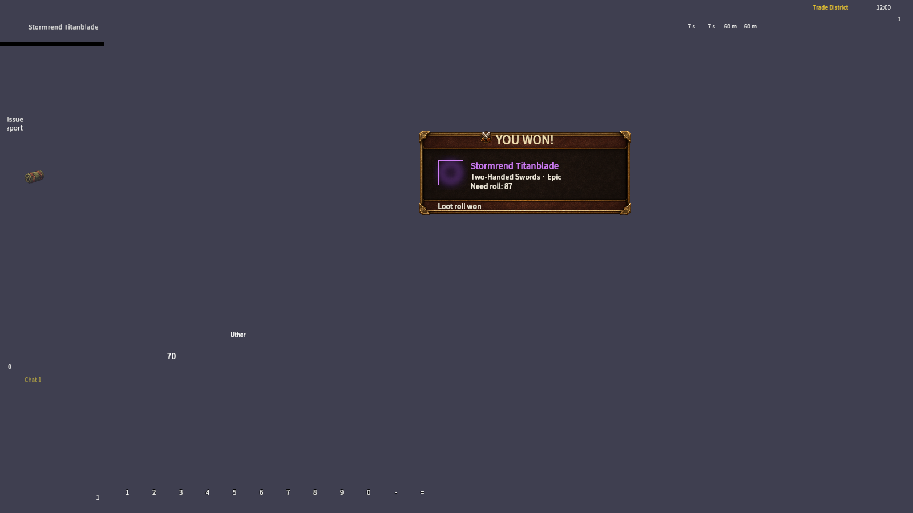
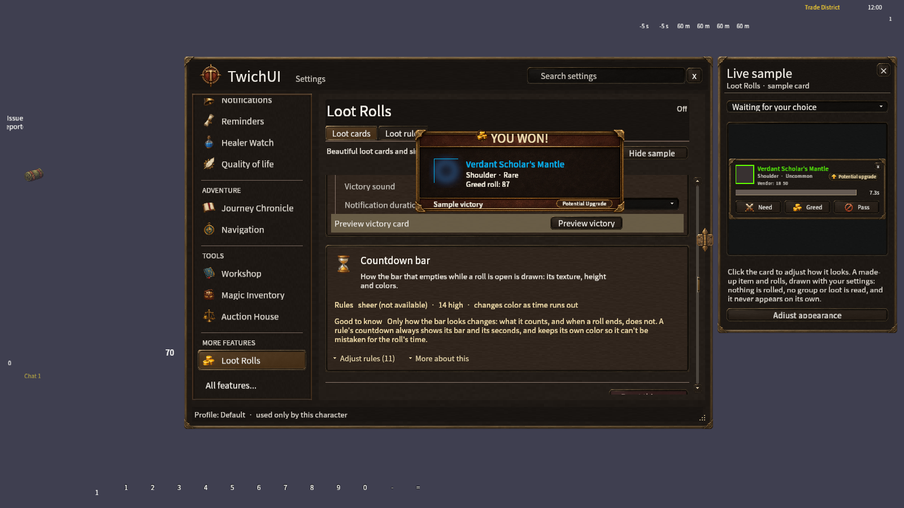

# Loot Victory verification evidence

Implementation: `f9028a7`, based on `origin/main` `725519e6be87f3e3b9c75d8f7ad271572cb60a1f`.
The retained captures were taken before committing, from identical source bytes;
[identity.json](identity.json) records the implementation/scenario/capture SHA-256s.
The staged simulator source was compared byte-for-byte with the committed files.

## Results

- **Unit-tested:** `tests/run.sh feature loot-rolls --profile cloud`: 58 modules
  passed; 191 Lua files plus runner/simulator syntax checks passed on frozen source.
- **Broad offline suite:** `tests/run.sh unit --profile cloud`: 314/315 modules passed.
  The only failure is preexisting `test_welcome_back.lua:84`, “two days back is a
  date”, reproduced in a clean detached worktree of unchanged `origin/main`
  `725519e`. The final run completed on frozen clean implementation `f9028a7`;
  no source-identity rejection occurred. This is not an all-green regression gate.
- **Simulator-tested:** final `loot` run: victoryStatic (7 checks), victoryGreed
  (6), victoryScaled (6), victoryDone (6), victorySettings (7); all passed. The
  settings preview was clicked twice through the real button handler while the
  module was disabled: Need then Greed, no RollOnLoot call, no accepted real result,
  and no OnUpdate at rest.
- **Simulator-tested:** resolution, reveal, sheen, particles, fade, animation Off
  and Loot Cards settings construction passed in earlier development captures.
  Final source has the same animation curves/layout; final captures below establish
  source identity for the delivered presentation.
- **Simulator-tested:** general smoke passed initialization and construction of all
  59 settings pages. Its known addon-message UTF-8 and unsupported voice-settings
  simulator failures were classified by the existing runner, not suppressed.
- **Screenshot-reviewed:** base proportions/crop, title/emblem placement, body/footer
  spacing, restrained trim/particle bounds, different emblems and 75% scale. The
  supplied static PNG and selected frames of the eight-frame supplied GIF were
  inspected as references. The footer intentionally uses accurate neutral wording.
- **Not tested:** native Forever rendering, real server events, actual winning-alert
  suppression, audio decoding/loudness/synchronization, combat/taint, pointer input,
  reload persistence, other alert addons or packaged-install acceptance.

The first broader campaign ran while changes were still being made; its source
identity guard rejected certification. A final frozen-source run replaced it.
A separate earlier feature run likewise rejected a commit changing source identity;
its checks were rerun on the frozen implementation. Failed outputs remain in
ignored test-output; no assertions were suppressed.

## Scope of the screenshots

These are **simulator structural captures**, with synthetic item/roll APIs.
Runtime: wow-ui-sim v0.1.37 Forever profile 1.60.1.70532, software renderer;
Blizzard source `ca8368f2f2380cbe696854f7f2646387c278a61b`. Game assets are
unavailable in this cloud lab, so actual game item icons do not render. Addon fonts
are replaced by a game font. These images do not establish native visual fidelity,
text wrapping, exact frame timing, or client suppression behavior.

[Need, Epic](victoryStatic.png) · [Greed, Uncommon](victoryGreed.png) ·
[75% card scale](victoryScaled.png) · [Settings preview](victorySettings.png) ·
[After timeout](victoryDone.png)

Architecture, native event/suppression findings, asset selection, animation timeline,
settings/defaults, performance bounds and the owner-directed in-game checklist are
in [Loot Victory](../../loot-victory.md).
