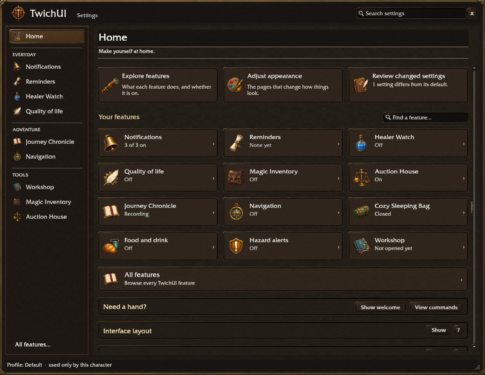

# Settings modernization tracker

The [second-pass workflow review](settings-second-pass.md) supersedes this first-pass quality classification. This record proves shared-style adoption and its recorded checks; those alone did not establish Reminders-level UX modernization for every page.

Work on `feature/style`, 2026-11-11. The working tree was clean when this assignment began. The existing Reminders revision record supplies the current implementation handoff. The root `Project Revision - Complete Requirements and Design Handoff.md` is a historical Reminders design record: its former no-rollout scope is superseded by this mission. `TwichUI-Workbench-Session-Handoff-2026-11-03.md` concerns a separate application and is outside this work. Both are preserved. No commit, push, deployment, release metadata change or live SavedVariables edit is authorized or performed.

Status vocabulary: **Not started → Audited → Planned → Implemented → Tested → Visually reviewed → Complete**. **Blocked** identifies an actual impediment, not a substitute for verification. A shared skin alone does not complete a page. The current matrix records purposeful page work separately from visual and functional evidence. Real-client acceptance is a separate requirement throughout.

## Baseline and boundaries

The four original images were opened: `docs/reminders-revision/SETTINGS_HOME.png`, `REMINDERS_PREVIEW.PNG`, `REMINDERS_WHEN_BUILDER.png`, `REMINDERS_TEMPLATE_CATALOG.jpeg`. The completed Reminders editor, live preview, When workspace, catalog, Advanced and selected/hover states remain the design reference.

**Simulator-tested / screenshot-reviewed baseline:** `../wow-ui-sim-lab/artifacts/reminders-20261111-073633/`: editor, catalog, when, actions, details, hover. Each pose passed 93–94 handler/state checks. Advanced baseline remains in the preceding verified `reminders-20261111-072004/` six-pose run; see [the detailed preservation record](reminders-revision/implementation.md). The final eight-pose regression run below rechecks these surfaces after shared changes. None of these screenshots proves client fonts or pointer delivery.

Core behavior, feature engines, profiles, defaults, validation, import/export and private drafts are unchanged. No migration is introduced. Configuration still loads only on first settings open; pages remain lazy and cached. The settings-local widget adapters never restyle live gameplay overlays. Stat weights and Refreshment shares use those adapters in their core-owned settings frames. No new background polling or diagnostics operation is introduced; existing settings performance scopes remain appropriate.

## Catalog and audit

The actual catalog has **58 registered pages** for a synthetic Mage with the optional Workshop launcher. A non-Mage has 56. The catalog is enumerated from `SettingsKit.NavOrder()`, including hosted pages and child tabs. Runtime availability predicates remain authoritative. See [the complete control inventory](settings-modernization-inventory.md) for each page's purpose, navigation, section/row IDs, control kinds, dependencies, saved variable names and defaults. Hosted editor controls and models remain in the source files linked below. The unchanged contract fixture records saved destinations and reset behavior; no schema or setting was removed.

Every page has passed **Audited → Planned → Implemented → Tested → Visually reviewed**. Offline work is complete; real-client acceptance is pending. Page introductions now describe a player task; existing full help stays available. Common forms receive concise sections, explicit secondary disclosures selected per page, and one visible prerequisite per disabled run. Search opens disclosures before revealing controls. Existing card workflows retain their direct switches, rules summaries, details and samples. Small pages intentionally keep their common controls visible; no artificial advanced view is added to a one-task form. Specialized editors retain their workflow after audit, with shared type, painted controls, wells and rails; this avoids replacing a working table or rule editor with a less useful generic form.

| Page / source | Previous usability issue | Purposeful changes | Visual status | Functional status | Focused existing unit coverage |
|---|---|---|---|---|---|
| [TwichUI](../TwichUI_Settings/pages/Overview.lua) (`overview`) | Dense full feature grid and explanatory help; flat tiles. | Reference-based action cards, twelve real feature states, local search, complete catalog, compact Help, secondary setup/General. Secondary: Interface layout, General. | Screenshot-reviewed; client pending | Unit-tested; common handlers simulator-tested (V1) | `test_settings_window.lua` |
| [Notifications](../TwichUI_Settings/pages/Notifications.lua) (`notifications`) | Long help competes with common controls; inconsistent components and scroll/header behavior. | Choose the moments you want to hear about. Concise section help; fixed heading and consistent controls. Secondary: Notification previews. | Screenshot-reviewed; client pending | Unit-tested; common handlers simulator-tested (V1) | `test_settings_window.lua`; `test_notify_look.lua` |
| [Notification appearance](../TwichUI_Settings/pages/Notifications.lua) (`notificationsLook`) | Long help competes with common controls; inconsistent components and scroll/header behavior. | Preview a card, then make it your own. Concise section help; fixed heading and consistent controls. Secondary: Divider, Accent and backdrop, Reset. | Screenshot-reviewed; client pending | Unit-tested; common handlers simulator-tested (V1) | `test_settings_window.lua`; `test_notify_look.lua` |
| [Reminders](../TwichUI_Settings/pages/Reminders.lua) (`reminders`) | Established reference; broad redesign would risk finished workflows. | Preserve editor, companions and validated behavior; shared shell/nav only; regression checks. | Screenshot-reviewed; client pending | Unit-tested; common handlers simulator-tested (V1) | `test_reminders_settings.lua`; `test_reminders_designer.lua` |
| [Known ammunition](../TwichUI_Settings/pages/AmmoItems.lua) (`ammoCustom`) | Long registration help and inconsistent input/list surfaces. | Concise registration help with full tooltip; painted input, classification dropdown and list; original registration/validation retained. | Screenshot-reviewed; client pending | Unit-tested; common handlers simulator-tested (V1) | `test_ammo_items_settings.lua` |
| [Healer Watch](../TwichUI_Settings/pages/HealerWatch.lua) (`healerWatch`) | Specialized editor competes with long introduction and inconsistent native controls. | Keep your healer's mana and messages in view. Shared type and painted controls/wells/rails; editor, drafts and actions preserved. | Screenshot-reviewed; client pending | Unit-tested; common handlers simulator-tested (V1) | `test_healer_watch_settings.lua` |
| [Return the Favor](../TwichUI_Settings/pages/ReturnTheFavor.lua) (`buffBack`) | Long help competes with common controls; inconsistent components and scroll/header behavior. | Choose which friendly buffs you want to return. Concise section help; fixed heading and consistent controls. | Screenshot-reviewed; client pending | Unit-tested; common handlers simulator-tested (V1) | `test_return_the_favor.lua` |
| [Quality of life](../TwichUI_Settings/pages/QoL.lua) (`qol`) | Long help competes with common controls; inconsistent components and scroll/header behavior. | Small conveniences. Choose what works for you. Concise section help; fixed heading and consistent controls. | Screenshot-reviewed; client pending | Unit-tested; common handlers simulator-tested (V1) | `test_settings_window.lua` |
| [Markers](../TwichUI_Settings/pages/Markers.lua) (`markers`) | Long help competes with common controls; inconsistent components and scroll/header behavior. | Mark targets and places with your own shortcuts. Concise section help; fixed heading and consistent controls. | Screenshot-reviewed; client pending | Unit-tested; common handlers simulator-tested (V1) | `test_markers.lua` |
| [Target markers](../TwichUI_Settings/pages/Markers.lua) (`markersTarget`) | Specialized editor competes with long introduction and inconsistent native controls. | Concise drag/order instruction; painted marker tiles, switches and reorder arrows; cycle and defaults unchanged. Secondary: Target marker keys. | Screenshot-reviewed; client pending | Unit-tested; common handlers simulator-tested (V1) | `test_markers.lua` |
| [World markers](../TwichUI_Settings/pages/Markers.lua) (`markersWorld`) | Specialized editor competes with long introduction and inconsistent native controls. | Same target-marker conventions for enable/order/drag/keys, with concise instruction and painted tiles. Secondary: World marker keys. | Screenshot-reviewed; client pending | Unit-tested; common handlers simulator-tested (V1) | `test_markers.lua` |
| [Marker bar](../TwichUI_Settings/pages/MarkerBar.lua) (`markersBar`) | Specialized editor competes with long introduction and inconsistent native controls. | Painted marker choices, compact checkmarks and sufficient host height; preview/move and original controls retained. Secondary: Size and look. | Screenshot-reviewed; client pending | Unit-tested; common handlers simulator-tested (V1) | `test_marker_bar.lua` |
| [Chat cleaning](../TwichUI_Settings/pages/ChatClean.lua) (`chatClean`) | Long help competes with common controls; inconsistent components and scroll/header behavior. | Keep the conversations you want to read. Concise section help; fixed heading and consistent controls. Secondary: Live view and test. | Screenshot-reviewed; client pending | Unit-tested; common handlers simulator-tested (V1) | `test_chat_clean.lua` |
| [Chat cleaning channels](../TwichUI_Settings/pages/ChatCleanChannels.lua) (`chatCleanChannels`) | Specialized editor competes with long introduction and inconsistent native controls. | Concise channel scope, aligned filter headings with full tooltips, shared switches and painted list well; filters unchanged. | Screenshot-reviewed; client pending | Unit-tested; common handlers simulator-tested (V1) | `test_chat_clean.lua` |
| [Chat cleaning rules](../TwichUI_Settings/pages/ChatCleanRules.lua) (`chatCleanRules`) | Specialized editor competes with long introduction and inconsistent native controls. | Short list instruction avoids header overlap; painted list/editor wells and controls; test messages remain in Live view. | Screenshot-reviewed; client pending | Unit-tested; common handlers simulator-tested (V1) | `test_chat_clean.lua` |
| [Chat cleaning live view](../TwichUI_Settings/pages/ChatCleanLive.lua) (`chatCleanLive`) | Specialized editor competes with long introduction and inconsistent native controls. | See what was filtered and test a message. Shared type and painted controls/wells/rails; editor, drafts and actions preserved. | Screenshot-reviewed; client pending | Unit-tested; common handlers simulator-tested (V1) | `test_chat_clean.lua` |
| [Food and drink](../TwichUI_Settings/pages/FoodDrink.lua) (`food`) | Long help competes with common controls; inconsistent components and scroll/header behavior. | Keep food and water ready to use. Concise section help; fixed heading and consistent controls. Secondary: Appearance. | Screenshot-reviewed; client pending | Unit-tested; common handlers simulator-tested (V1) | `test_food_drink.lua` |
| [Camping bar](../TwichUI_Settings/pages/Camping.lua) (`camping`) | Long help competes with common controls; inconsistent components and scroll/header behavior. | Your camp essentials in one place. Concise section help; fixed heading and consistent controls. Secondary: Appearance. | Screenshot-reviewed; client pending | Unit-tested; common handlers simulator-tested (V1) | `test_camping.lua` |
| [Sleeping bag bar](../TwichUI_Settings/pages/CampingRest.lua) (`campingRest`) | Long help competes with common controls; inconsistent components and scroll/header behavior. | Watch your Sleeping Bag rest progress. Concise section help; fixed heading and consistent controls. Secondary: Notches, Border, Text, When it ends. | Screenshot-reviewed; client pending | Unit-tested; common handlers simulator-tested (V1) | `test_camping.lua` |
| [Hazard alerts](../TwichUI_Settings/pages/Hazard.lua) (`hazard`) | Long help competes with common controls; inconsistent components and scroll/header behavior. | Choose sounds for the auras you want to notice. Concise section help; fixed heading and consistent controls. Secondary: Volume, Built-in rules, Reset. | Screenshot-reviewed; client pending | Unit-tested; common handlers simulator-tested (V1) | `test_hazard_settings.lua` |
| [Hazard alert rules](../TwichUI_Settings/pages/HazardRules.lua) (`hazardRules`) | Specialized editor competes with long introduction and inconsistent native controls. | Short aura/event instruction avoids list overlap; painted list/editor controls; sound categories and validation retained. | Screenshot-reviewed; client pending | Unit-tested; common handlers simulator-tested (V1) | `test_hazard_settings.lua` |
| [Vendor restocking](../TwichUI_Settings/pages/Restock.lua) (`restock`) | Long help competes with common controls; inconsistent components and scroll/header behavior. | Choose what to keep stocked at merchants. Concise section help; fixed heading and consistent controls. Secondary: Question window appearance. | Screenshot-reviewed; client pending | Unit-tested; common handlers simulator-tested (V1) | `test_restock_settings.lua` |
| [Restock items](../TwichUI_Settings/pages/RestockItems.lua) (`restockItems`) | Specialized editor competes with long introduction and inconsistent native controls. | Short add/quantity guidance, quieter illustrated class suggestions and shared inputs; purchase behavior unchanged. | Screenshot-reviewed; client pending | Unit-tested; common handlers simulator-tested (V1) | `test_restock_settings.lua` |
| [Workshop](../TwichUI_Settings/pages/Workshop.lua) (`workshop`) | Specialized editor competes with long introduction and inconsistent native controls. | Task introduction, shared painted tooltip-line list and segments; switch label follows its real width; load gate, mockup and drag/click alternatives retained. Secondary: What it does, Shopping, Opportunities. | Screenshot-reviewed; client pending | Unit-tested; common handlers simulator-tested (V1) | `test_workshop_worth_designer.lua`; `test_workshop_window.lua` |
| [Magic Inventory](../TwichUI_Settings/pages/MagicInventory.lua) (`magicInventory`) | Specialized editor competes with long introduction and inconsistent native controls. | Coordinated satchel, painted rule steps, guild tabs/slots and selected tab; automatic-layout choice sits below its heading at narrow width; private drafts and review retained. | Screenshot-reviewed; client pending | Unit-tested; common handlers simulator-tested (V1) | `test_magic_inventory_settings.lua`; `test_magic_inventory_editor.lua`; `test_magic_inventory_guildrun_ui.lua` |
| [Auction House](../TwichUI_Settings/pages/Auction.lua) (`auction`) | Long help competes with common controls; inconsistent components and scroll/header behavior. | Keep selling and collecting mail close at hand. Concise section help; fixed heading and consistent controls. | Screenshot-reviewed; client pending | Unit-tested; common handlers simulator-tested (V1) | `test_auction_window.lua` |
| [Journey Chronicle](../TwichUI_Settings/pages/Chronicle.lua) (`chronicle`) | Long help competes with common controls; inconsistent components and scroll/header behavior. | Keep a journal of your adventures. Concise section help; fixed heading and consistent controls. | Screenshot-reviewed; client pending | Unit-tested; common handlers simulator-tested (V1) | `test_chronicle.lua` |
| [Chronicle appearance](../TwichUI_Settings/pages/Chronicle.lua) (`chronicleLook`) | Long help competes with common controls; inconsistent components and scroll/header behavior. | Make your journal comfortable to read. Concise section help; fixed heading and consistent controls. Secondary: Border, Controls and accents. | Screenshot-reviewed; client pending | Unit-tested; common handlers simulator-tested (V1) | `test_chronicle_appearance.lua` |
| [Cozy Sleeping Bag](../TwichUI_Settings/pages/CozyBag.lua) (`cozyBag`) | Long help competes with common controls; inconsistent components and scroll/header behavior. | Follow your progress toward the Cozy Sleeping Bag. Concise section help; fixed heading and consistent controls. Secondary: Previews. | Screenshot-reviewed; client pending | Unit-tested; common handlers simulator-tested (V1) | `test_cozy_bag.lua` |
| [Pins and Pings](../TwichUI_Settings/pages/Pins.lua) (`pins`) | Long help competes with common controls; inconsistent components and scroll/header behavior. | Save places and share a destination with your group. Concise section help; fixed heading and consistent controls. Secondary: Data bar, Sound, Appearance. | Screenshot-reviewed; client pending | Unit-tested; common handlers simulator-tested (V1) | `test_party_pins_ui.lua` |
| [Map pings](../TwichUI_Settings/pages/Pins.lua) (`pings`) | Long help competes with common controls; inconsistent components and scroll/header behavior. | Point out a place to your group. Concise section help; fixed heading and consistent controls. | Screenshot-reviewed; client pending | Unit-tested; common handlers simulator-tested (V1) | `test_map_ping.lua` |
| [Pin appearance](../TwichUI_Settings/pages/Pins.lua) (`pinsLook`) | Long help competes with common controls; inconsistent components and scroll/header behavior. | Choose how your pins, labels and windows look. Concise section help; fixed heading and consistent controls. Secondary: Data bar menu appearance, New pin window appearance. | Screenshot-reviewed; client pending | Unit-tested; common handlers simulator-tested (V1) | `test_party_pins_ui.lua` |
| [Map Toolbar](../TwichUI_Settings/pages/MapToolbar.lua) (`mapToolbar`) | Long help competes with common controls; inconsistent components and scroll/header behavior. | Keep your map tools and filters together. Concise section help; fixed heading and consistent controls. | Screenshot-reviewed; client pending | Unit-tested; common handlers simulator-tested (V1) | `test_map_tools.lua` |
| [World map](../TwichUI_Settings/pages/WorldMap.lua) (`worldMap`) | Long help competes with common controls; inconsistent components and scroll/header behavior. | Make the world map easier to explore. Concise section help; fixed heading and consistent controls. Secondary: Detail. | Screenshot-reviewed; client pending | Unit-tested; common handlers simulator-tested (V1) | `test_map_explore.lua` |
| [World map places](../TwichUI_Settings/pages/WorldMap.lua) (`worldMapPlaces`) | Long help competes with common controls; inconsistent components and scroll/header behavior. | Choose the places shown on your map. Concise section help; fixed heading and consistent controls. | Screenshot-reviewed; client pending | Unit-tested; common handlers simulator-tested (V1) | `test_map_explore.lua` |
| [Navigation](../TwichUI_Settings/pages/Navigation.lua) (`navigation`) | Long help competes with common controls; inconsistent components and scroll/header behavior. | Choose how you follow a route. Concise section help; fixed heading and consistent controls. Secondary: Getting there, Arriving and leaving the route. | Screenshot-reviewed; client pending | Unit-tested; common handlers simulator-tested (V1) | `test_nav.lua`; `test_nav_unlock.lua` |
| [Navigation appearance](../TwichUI_Settings/pages/Navigation.lua) (`navigationLook`) | Specialized editor competes with long introduction and inconsistent native controls. | Preview your route display while you adjust it. Shared type and painted controls/wells/rails; editor, drafts and actions preserved. Secondary: Frame theme, Frame background and border. | Screenshot-reviewed; client pending | Unit-tested; common handlers simulator-tested (V1) | `test_nav_unlock.lua` |
| [Vendors and trainers](../TwichUI_Settings/pages/Npcs.lua) (`npcs`) | Long help competes with common controls; inconsistent components and scroll/header behavior. | Remember the vendors and trainers you discover. Concise section help; fixed heading and consistent controls. Secondary: How they show. | Screenshot-reviewed; client pending | Unit-tested; common handlers simulator-tested (V1) | `test_npcs.lua` |
| [Vendors and trainers: your list](../TwichUI_Settings/pages/Npcs.lua) (`npcsList`) | Long help competes with common controls; inconsistent components and scroll/header behavior. | Manage and share your discovered services. Concise section help; fixed heading and consistent controls. Secondary: Checking what the game reports, Remove. | Screenshot-reviewed; client pending | Unit-tested; common handlers simulator-tested (V1) | `test_npcs.lua` |
| [World Knowledge](../TwichUI_Settings/pages/NpcKnowledge.lua) (`npcsKnowledge`) | Specialized editor competes with long introduction and inconsistent native controls. | Short service-search instruction, spaced filters/column headings, shared list/details surfaces; sharing and removal controls retained. | Screenshot-reviewed; client pending | Unit-tested; common handlers simulator-tested (V1) | `test_npcs_knowledge_page.lua` |
| [Guild Locations](../TwichUI_Settings/pages/GuildLocations.lua) (`guildLocations`) | Long help competes with common controls; inconsistent components and scroll/header behavior. | Choose whether guildmates can see your location. Concise section help; fixed heading and consistent controls. Sending/Invisible/Off consequences remain visible. | Screenshot-reviewed; client pending | Unit-tested; common handlers simulator-tested (V1) | `test_guild_locations_settings.lua` |
| [Gear comparison](../TwichUI_Settings/pages/Gear.lua) (`gear`) | Long help competes with common controls; inconsistent components and scroll/header behavior. | Choose where you see estimated gear upgrades. Concise section help; fixed heading and consistent controls. | Screenshot-reviewed; client pending | Unit-tested; common handlers simulator-tested (V1) | `test_gear.lua` |
| [Stat weights](../TwichUI_Settings/pages/Gear.lua) (`statWeights`) | Specialized editor competes with long introduction and inconsistent native controls. | Choose a class and talent tree, then adjust its stat weights. Shared type and painted controls/wells/rails; editor, drafts and actions preserved. | Screenshot-reviewed; client pending | Unit-tested; common handlers simulator-tested (V1) | `test_gear_window.lua` |
| [Mage](../TwichUI_Settings/pages/Mage.lua) (`mage`) | Long help competes with common controls; inconsistent components and scroll/header behavior. | Keep travel, conjuring and refreshments ready. Concise section help; fixed heading and consistent controls. Secondary: Broker menu appearance, Refreshments panel appearance. Merchant-selling and dry-run consequences remain visible. | Screenshot-reviewed; client pending | Unit-tested; common handlers simulator-tested (V1) | `test_mage_sell_settings.lua` |
| [Refreshment shares](../TwichUI_Settings/pages/Mage.lua) (`refreshmentShares`) | Specialized editor competes with long introduction and inconsistent native controls. | Plan the refreshments you want to share with your group. Shared type and painted controls/wells/rails; editor, drafts and actions preserved. | Screenshot-reviewed; client pending | Unit-tested; common handlers simulator-tested (V1) | `test_refreshments.lua` |
| [Class resource bars](../TwichUI_Settings/pages/ClassBars.lua) (`classBars`) | Long help competes with common controls; inconsistent components and scroll/header behavior. | Choose your resources and when to show them. Concise section help; fixed heading and consistent controls. Secondary: Reset. | Screenshot-reviewed; client pending | Unit-tested; common handlers simulator-tested (V1) | `test_class_bars_settings.lua` |
| [Class resource bar layout](../TwichUI_Settings/pages/ClassBars.lua) (`classBarsLayout`) | Long help competes with common controls; inconsistent components and scroll/header behavior. | Arrange your resource bars. Concise section help; fixed heading and consistent controls. Secondary: Reset. | Screenshot-reviewed; client pending | Unit-tested; common handlers simulator-tested (V1) | `test_class_bars_settings.lua` |
| [Class resource bar appearance](../TwichUI_Settings/pages/ClassBars.lua) (`classBarsLook`) | Long help competes with common controls; inconsistent components and scroll/header behavior. | Choose the shared look, then customize individual resources. Concise section help; fixed heading and consistent controls. Secondary: Background and border, Reset. | Screenshot-reviewed; client pending | Unit-tested; common handlers simulator-tested (V1) | `test_class_bars_settings.lua` |
| [Class resource bar effects](../TwichUI_Settings/pages/ClassBars.lua) (`classBarsEffects`) | Long help competes with common controls; inconsistent components and scroll/header behavior. | Choose the moments your resource bars emphasize. Concise section help; fixed heading and consistent controls. Secondary: Reset. | Screenshot-reviewed; client pending | Unit-tested; common handlers simulator-tested (V1) | `test_class_bars_settings.lua` |
| [Action bar glows](../TwichUI_Settings/pages/BarGlows.lua) (`barGlows`) | Long help competes with common controls; inconsistent components and scroll/header behavior. | Make the action buttons you care about stand out. Concise section help; fixed heading and consistent controls. | Screenshot-reviewed; client pending | Unit-tested; common handlers simulator-tested (V1) | `test_bar_glows_settings.lua` |
| [Action bar glow spells and looks](../TwichUI_Settings/pages/BarGlowsSpells.lua) (`barGlowsSpells`) | Specialized editor competes with long introduction and inconsistent native controls. | Concise kind/list guidance prevents overlap; shared inputs and list/editor wells; type defaults, individual overrides and live sample retained. | Screenshot-reviewed; client pending | Unit-tested; common handlers simulator-tested (V1) | `test_bar_glows_settings.lua` |
| [Addon skins](../TwichUI_Settings/pages/Skins.lua) (`skins`) | Long help competes with common controls; inconsistent components and scroll/header behavior. | Make supported addons feel at home with TwichUI. Concise section help; fixed heading and consistent controls. | Screenshot-reviewed; client pending | Unit-tested; common handlers simulator-tested (V1) | `test_settings_window.lua` |
| [SpeakStone speech frame](../TwichUI_Settings/pages/SpeakStone.lua) (`speakstone`) | Long help competes with common controls; inconsistent components and scroll/header behavior. | Make dialogue comfortable to read. Concise section help; fixed heading and consistent controls. Secondary: Controls, Portrait, Progress line. | Screenshot-reviewed; client pending | Unit-tested; common handlers simulator-tested (V1) | `test_speakstone_skin.lua` |
| [RestedXP](../TwichUI_Settings/pages/RestedXP.lua) (`restedxp`) | Long help competes with common controls; inconsistent components and scroll/header behavior. | Choose your guide's behavior and appearance. Concise section help; fixed heading and consistent controls. Secondary: Window background and border, Current step, Header and footer, Text size, Spacing, Scroll bar, Waypoint arrow, Timer bars, Timer bar background and border. | Screenshot-reviewed; client pending | Unit-tested; common handlers simulator-tested (V1) | `test_restedxp_skin.lua` |
| [Target dragon artwork](../TwichUI_Settings/pages/TargetArt.lua) (`targetArt`) | Specialized editor competes with long introduction and inconsistent native controls. | Choose dragon artwork for your target frame. Shared type and painted controls/wells/rails; editor, drafts and actions preserved. Secondary: Fine-tune each artwork, Reset. | Screenshot-reviewed; client pending | Unit-tested; common handlers simulator-tested (V1) | `test_target_art.lua` |
| [Configuration sharing](../TwichUI_Settings/pages/Sharing.lua) (`sharing`) | Long help competes with common controls; inconsistent components and scroll/header behavior. | Share selected configurations and review incoming changes. Concise section help; fixed heading and consistent controls. | Screenshot-reviewed; client pending | Unit-tested; common handlers simulator-tested (V1) | `test_twichui_share.lua` |
| [Profiles](../TwichUI_Settings/pages/Profiles.lua) (`profiles`) | Long help competes with common controls; inconsistent components and scroll/header behavior. | Choose the settings this character uses. Concise section help; fixed heading and consistent controls. Secondary: Delete or reset. Shared-profile consequence remains visible; destructive controls separated. | Screenshot-reviewed; client pending | Unit-tested; common handlers simulator-tested (V1) | `test_profiles.lua` |
| [Troubleshooting](../TwichUI_Settings/pages/Troubleshooting.lua) (`troubleshooting`) | Long help competes with common controls; inconsistent components and scroll/header behavior. | Check status, then open the tools you need. Concise section help; fixed heading and consistent controls. Secondary: Temporary tracing. | Screenshot-reviewed; client pending | Unit-tested; common handlers simulator-tested (V1) | `test_status.lua` |

**Matrix evidence key V1:** every row was rendered in the 58-page wide run, inspected in the indexed contact sheets, and exercised by the catalog scenario's available disclosure/dropdown/search/reopen checks. The full unit suite includes the focused tests listed per row and the unchanged settings contract. This does **not** mean every feature control, populated editor state or real pointer path was exercised. Additional populated-editor and reference checks are listed below. The shared remaining limitation for every row is native fonts/input/combat/reload/optional integrations; see Real-client acceptance.

## Home behavior and reference differences

Explore features opens the entire registered feature catalog. Adjust appearance lists existing appearance tabs and supported skin/art pages. Changed settings uses `Kit.Changed()` and shows current versus default values; it is not historical change tracking. Each feature card calls the existing page navigation API and reads the feature's own overview status. The featured collection is curated, not a claimed enabled-feature list. Local search covers the entire catalog, including features outside that collection. All features and the persistent sidebar entry expose every top-level page. Footer profile navigation and the existing welcome / command actions remain authoritative.

The Home layout follows the approved image's three action cards, three-column wide feature collection, local search, All features card, help region and profile footer. The minimum width uses two feature columns and taller action cards to preserve legibility. Current feature names and actual availability replace mockup examples. Existing branding and the approved painted component family are reused rather than tracing the reference pixels. Settings retain their established default 936×660 size and saved placement; the large screenshot pose uses only a synthetic lab size. Font appearance still requires the real client. The sculpted border and original icon paintings follow the reference material family; icon paintings, exact ornaments and card proportions are adapted to the existing reusable art and supported window sizes. There is no claimed pixel-perfect match.

**Screenshot-reviewed:** this is the native 1240×960 settings-window region from `settings-20261111-082133/overview.png`, cropped only to omit the surrounding game scene. No screenshot is used as runtime UI.

## Discrepancy register

| ID / priority | Evidence | Resolution / verification |
|---|---|---|
| S01 / P0 | Initial generic segment buttons did not implement SetSelected because a default adapter had claimed them. | Segment creation now selects its silhouette first; unit window test and 56/56 construction smoke pass. |
| S02 / P1 | First Home screenshot at minimum width wrapped card text below the card. | Card height follows measured title and description; final wide and narrow Home captures inspected. |
| S03 / P1 | First-sentence trimming could reduce Guild Locations help to “On by default.” or Mage selling to “Optional.” | Curated consequence summaries keep sending, selling, dry-run, sharing and purchase semantics visible; privacy assertion is unit-tested. |
| S04 / P1 | Generic button styling could swallow an explicit confirmation/primary role. | Role refinement reuses painted textures and listeners; focused Reminders unit test passes. |
| S05 / P2 | Initial Home help occupied a full multi-row form beneath the catalog. | Existing actions now share a compact help band; original callbacks and searchable IDs retained. |
| S06 / P2 | Long sidebar repeated the complete catalog and pushed discovery/configuration far down. | Reference shortcuts, persistent All features, and contextual selected-feature row. Repeated navigation unit-tested; pointer/scroll client checks pending. |
| S07 / P2 | The same prerequisite sentence repeated beneath every disabled child control. | Show it once per consecutive disabled run; full per-control help retained. Unit window regression passes. |
| S08 / P2 | Simulator invokes SetText notification on a subsequent frame. | Scenario settles the native clock before filter assertions; no production workaround. |
| S09 / P1 | Hosted instructions overlapped list headings; marker-bar tiles crowded the next section. | Short/full-tooltip help, extra filter space and correct marker-bar host height; wide pass plus all ten targeted narrow captures reviewed. |
| S10 / P1 | Default painted button width could constrain tab labels; compact tabs used the old control path. | Both paths use measured painted segments; all-page unit/native label-fit checks pass and tab states are screenshot-reviewed. |
| S11 / P1 | A pill squeezed into a 16-unit table cell obscured its on/off state. | Dense cells use a recessed square with an explicit checkmark; enabled/disabled callback behavior unit-tested, marker-bar screenshot reviewed. |
| S12 / P2 | Dynamic confirmation labels and long footer profiles could collide or clip. | Size-aware label bounds and bounded footer text/full tooltip; unit suite passes, final Home/Profiles captures reviewed. Client long-font check remains. |
| S13 / P1 | Populated guild arrangement put its automatic-layout dropdown over the heading at 936 width. | Dropdown now follows the measured heading; populated assignment/split scenario passes 12/0, native screenshot reviewed. |
| S14 / P1 | Workshop's wider shared switch overlapped Enable tooltip; hosted list and tabs retained older surfaces. | Relative label anchor and shared painted well/segment controls; 345/0 designer checks, final screenshot reviewed. |
| S15 / P2 | Search descriptions clipped long sentences at both supported widths. | Wrapped summaries, full-help hover and resize reflow retain selection/offset; unit window test and wide/narrow actual-field scenarios pass; screenshots reviewed. |
| S16 / fixture | Existing Notifications fixture assumed a solo client made no sends; default Guild Locations now sends a synthetic guild update. | Turn Guild Locations off through its real setter before installing the send watcher. Only the fixture changes; repeatable 74/0 and exact negative control pass. No production default or messaging change. |

## Verification record

All artifact run names below are relative to `../wow-ui-sim-lab/artifacts/`. Repository logs and final review crops live in `test-output/settings-modernization/`. Screenshots are structural evidence with fallback fonts.

| Evidence | Result and coverage |
|---|---|
| **Unit-tested** — `./tests/run.sh` | 188 passed, 0 failed in both `unit-suite-release-candidate.log` and the final post-populated-editor `unit-suite-final.log`. Focused settings-window, design, Reminders, Workshop designer, gear and Magic Inventory UI tests pass. The settings contract retains its original 770 settings / 1,171 rows fixture. |
| **Simulator-tested** — `smoke-20261111-082231` | 56/56 available construction pages pass, no captured Lua error or missing TwichUI texture. This non-Mage fixture is construction evidence. |
| **Simulator-tested / screenshot-reviewed** — `settings-20261111-074922` then `settings-20261111-080603` | Two wide renders of all 58 registered pages, all handler/state checks pass. All 58 final wide captures inspected in `review/01.png` through `15.png`, mapped by `review/index.txt`. Reference-comparison refinements followed the first review; targeted captures verify subsequent fixes. |
| **Simulator-tested** — `settings-20261111-075646` | All 58 pages rendered and passed at 936×660 after the initial shared rollout. This is an intermediate narrow pass, not the final screenshot set. |
| **Simulator-tested / screenshot-reviewed** — `settings-20261111-081415` | Ten final narrow captures: Home, ammunition, target markers, marker bar, channels, chat rules, hazard rules, World Knowledge, glow spells and Profiles; 8–21 handler/state assertions each, all pass. All ten inspected. |
| **Simulator-tested / screenshot-reviewed** — `settings-20261111-082133` | Final Home and channels, 21 / 12 checks; visible art, state, header, profile footer and reference selection inspected. [Home crop](../test-output/settings-modernization/home-final.png). |
| **Simulator-tested / screenshot-reviewed** — global search | `settings-20261111-083100` (wide) and `settings-20261111-083108` (narrow), 22/0 each after text-wrap refinement; query is entered through the actual edit field. Logs: `search-final.log` and `search-narrow-final.log`; [wide crop](../test-output/settings-modernization/search-final.png). Full help remains available on hover. |
| **Simulator-tested / screenshot-reviewed** — `reminders-20261111-081629` | Editor, catalog, When and hover: 93 assertions per pose. Advanced collapsed, expanded, nested-bottom and diagnostics: 103 each. Eight final poses inspected; editor/preview/lifecycle, private conditions, controls and painted reference materials retained. |
| **Simulator-tested / screenshot-reviewed** — `interact-20261111-082036` | Notifications Appearance: 74/0 twice, identical synthetic state; 22-check initial pose; negative control fails only its deliberately wrong expectation. Known voice-settings simulator API errors remain classified. Before/after settings captures inspected. No claim of actual pointer input. |
| **Simulator-tested / screenshot-reviewed** — `workshop-20261111-082832` | Crafting 344/0, Opportunities 345/0, Shopping 346/0, populated tooltip designer 345/0; negative control has only the expected failure. Designer screenshot inspected after switch/segment/list fixes. Known voice API and addon-message UTF-8 simulator errors are disclosed, not suppressed. [Designer crop](../test-output/settings-modernization/workshop-final.png). |
| **Simulator-tested / screenshot-reviewed** — `guildbank-20261111-082907` | Populated arrangement at 936×660, 12/0 checks; original assignment/split/draft rules preserved. Heading/layout separation, painted slots/tabs and selected tab inspected. Two known voice-settings API errors remain in the log. [Arrangement crop](../test-output/settings-modernization/guildbank-final.png). |
| **Not real-client-tested** | Native fonts/wrapping, pointer/keyboard/focus, actual thumb dragging and item drag/drop, combat/taint, addon-message delivery, reload persistence, external integrations and packaged install. |

The catalog scenario enumerates `SettingsKit.NavOrder()` from a synthetic Mage, including the optional Workshop launcher without loading it merely to describe it. It checks available disclosures, direct reveal, one enabled dropdown per page where present, no-results search, cached reopen, and unchanged settings-change count. Home additionally checks local filtering, complete catalog and its appearance/default-comparison actions. Feature-specific unit tests and populated scenarios provide additional evidence; the catalog checks do not exercise every control.

The simulator substitutes fonts and prefix-registration APIs. Its native PTR feedback frame was positioned beside settings in the capture fixture; no simulator engine or Blizzard source was modified. Alternating table stripes are specified as 3–3.5% alpha; their rendering, unknown spell labels under synthetic data and unavailable optional integrations require client comparison. The original full-suite attempt overlapped creation of the new TOC file and is invalid as a pre-change baseline. Intermediate role/default-fixture/provenance failures were corrected and followed by passing runs; old logs are retained as evidence, not reported as current failures.

## Hosted editor audit

The generated inventory lists ordinary controls, dependencies, defaults and stable IDs. These custom models supply additional controls without Kit rows; their existing storage, bounds and validation remain feature-owned. No custom saved schema changed.

| Page / source | Preserved tasks and controls | Usability decision / dependency |
|---|---|---|
| [Reminders](../TwichUI_Settings/pages/Reminders.lua) | Master/per-reminder toggle; New, template catalog, duplicate/delete; name, artwork/text/color/size, sound; When with targeting, Undo/Redo, Save/Cancel; live preview; placement; Advanced and diagnostics. | Preserve the approved workflow and private transactions; no second redesign. Runtime reminder/condition models remain authoritative. |
| [Ammunition](../TwichUI_Settings/pages/AmmoItems.lua) | Drop/link/item ID, Automatic/Arrow/Bullet classification, Add, per-item classification/remove; game-known ammunition still automatic. | Registration only, no equip/move action; concise help with full tooltip. |
| [Healer Watch](../TwichUI_Settings/pages/HealerWatch.lua) | Scenario/preview and move/flash; phrase text/mode/add/remove/reset/test; broad mana matching and diagnostics. | Existing concise feature card/rule workflow retained; advanced diagnostics accessible. |
| [Marker order](../TwichUI_Settings/pages/Markers.lua) | Eight enabled/order tiles, drag and click arrows, cycle/restart behavior, key assignments, reset confirmation. | Painted recognition tiles; dragging retains keyboard/button alternatives and disabled positions. |
| [Marker bar](../TwichUI_Settings/pages/MarkerBar.lua) | Eight displayed-marker choices, live preview/move and size/look. | Compact explicit checkmarks preserve the small hit regions; host height prevents following-section overlap. |
| [Channel filters](../TwichUI_Settings/pages/ChatCleanChannels.lua) | Channel cleaning toggle plus built-in filter columns, custom rule counts, recommended-channel reset. | Short column labels retain full help; whispers/group/guild/system scope remains visible. |
| [Chat rules](../TwichUI_Settings/pages/ChatCleanRules.lua) | Enable/edit/order/remove, match text/mode/name/case/channel scope, all channels, Save/Cancel. | Preserve private rule editing; shorter introduction leaves list headings clear. |
| [Chat live view](../TwichUI_Settings/pages/ChatCleanLive.lua) | Sample/channel/Try, Pause/Clear and bounded session log. | Existing testing view retained beside rule workflow; no background log expansion. |
| [Hazard rules](../TwichUI_Settings/pages/HazardRules.lua) | Enable/test/copy/order/edit/remove; spell ID/name/event/category/cooldown; Save/Cancel. | Aura limitation remains visible; categories retain original meaning and validation. |
| [Restock items](../TwichUI_Settings/pages/RestockItems.lua) | Drop/item ID/Add, target quantity, enable/order/remove, class suggestions/search. | Concise add/quantity task; purchases continue through existing mode/limit/confirmation. |
| [Magic Inventory](../TwichUI_Settings/pages/MagicInventory.lua), [guild arrangement](../TwichUI_Settings/pages/MagicInventoryGuild.lua) | Templates; Items/Destination/Exceptions/Review; keep/remove/mail/bank/guild destinations; Never transfer; tab/slot/shelf assignments, split/merge; private arrangement Save/Revert; reviewed Preview/Deposit/Organize. | Painted steps, tabs and slots; layout choice moves below its heading at narrow width. No inventory executor or cursor behavior changed. |
| [Workshop tooltip](../TwichUI_Settings/pages/WorkshopWorth.lua) | Safe optional load gate; enable/example, Normal/Hold Shift; add/select/order/drag/remove, Move up/down, Always/Hold Shift, Reset; shared tooltip mockup. | Painted list/segments; label follows switch width. Tooltip preview intentionally retains the actual tooltip's appearance. |
| [Navigation look](../TwichUI_Settings/pages/Navigation.lua) | Sample route preview, frame/arrow/text/trail fields. | Shared canvas; frame-theme fine tuning disclosed, common controls visible. |
| [World Knowledge](../TwichUI_Settings/pages/NpcKnowledge.lua) | Search/area/role/source/reset, table/select/details, send selected/filtered to group/guild/player, exact-delete/area-clear confirmations. | More filter/header space and short instruction; sharing and destructive scope remain intact. |
| [Stat weights](../!!!TwichUI/gear/Window.lua) | Class/tree, priorities/weights, numeric attributes with blank-as-default, add/remove/reorder and selected-tree reset. | Shared type and recessed work area; preserve specialized table and talent-tree selection. |
| [Refreshment shares](../!!!TwichUI/modules/RefreshmentsShares.lua) | Per-class party/raid food/water amounts, own reserve, zero means none, reset. | Short units explanation; full rank/reserve help retained; class grid remains direct editing. |
| [Glow spells](../TwichUI_Settings/pages/BarGlowsSpells.lua) | Kind/default and per-entry enable/Look/Reset/remove; art/color/strength/size/speed/reduced-motion/timing/message/sound/threshold; add spell/item/aura/equipment slot. | Short list guidance; painted inputs/wells; actual sample still demonstrates the player's glow. |
| [Target artwork](../TwichUI_Settings/pages/TargetArt.lua) | Six representative target samples, live preview, fit/per-art fine tuning. | Shared preview canvas; concise preview instructions and disclosed fine tuning; live target artwork unchanged. |

## Real-client acceptance

At normal UI scale and a larger font, open Home, its three actions, local search, All features, a contextual sidebar page and Profiles. Check tab labels, tooltip placement, folded search results, slider entry, switches, dropdown dismissal, wheel/thumb scrolling and the resize grip. Confirm a profile change refreshes controls; reload a disposable profile and confirm values persist. Check settings close/navigation do not show a Reminders companion in gameplay. Exercise the existing Reminders Advanced, When Save/Cancel, placement Finish/Cancel and template creation checks. Use normal supported player input; do not test consequential mail, auctions, selling or bank operations on valuable data.

## Remaining issues and acceptance limits

- **Not real-client-tested:** typography and wrapping with Spectral/Alegreya Sans, supported locales, larger fonts and UI scales. Simulator captures use Friz Quadrata. Exact mockup ornaments and proportions are adapted as described above; no pixel-perfect equivalence is claimed.
- **Not real-client-tested:** pointer hit regions, actual keyboard focus/Escape ordering, drag/drop, thumb dragging, combat/taint, optional addon states, packaged first open and persistence across reload. Existing unit/handler tests are evidence for their own narrower contracts.
- Native compact reorder arrows, color swatches, confirmation dialogs and the Workshop's actual tooltip preview retain purpose-specific native presentation. The shared frame/card/selection/input system surrounds them; they have not been replaced by painted screenshots or a competing modal system.
- Full populated-state coverage of every optional external integration is unavailable in the simulator. The audit preserves each existing control and setter; the table above names the specialized models and extra scenarios actually exercised.
- No unresolved addon P0/P1 regression was observed in the completed offline checks. Native-client acceptance is outstanding; no deployment, commit or live-player-data change was performed.

## Design reference

[Shared design-system specification](settings-design-system.md). Runtime assets are under `!!!TwichUI/media/style-v2/craft/`, `media/reminders/materials/` and `media/icons/`. One new generated satchel source is prepared by `tools/make_settings_home_art.py`; the remaining artwork is reused. `Design.lua` owns page presentation choices, `Material.lua` and `Craft.lua` own reusable painted components, `Widgets.lua` and native WoW objects own interactions, and feature code owns behavior.

Final repository checks: all 30 changed/new Lua files pass `luac5.1 -p`; `git diff --check` passes. The matrix and `test-output/settings-modernization/capture-index.json` enumerate the same 58 runtime page keys. The index records each broad-pass screenshot's hash and simulator result; later focused captures remain explicitly identified above.
