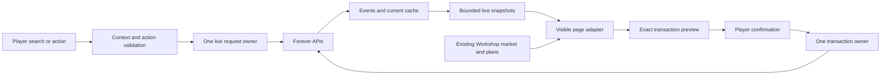

# AH-0: Replacement-window architecture

Status: the full replacement below remains proposed. AH-1a implements only the
disabled diagnostic [lifecycle proof](lifecycle-proof.md), with no shell/pages or
automatic takeover. **Real-client acceptance is pending; native replacement is blocked.** The separately authorized [standalone presentation](presentation.md) implements the shell, Browse and Shopping without takeover. Source facts and unresolved API
contracts are in [api-capabilities.md](api-capabilities.md). This document does
not authorize AH-1. The approved result is one complete Auction House window
with Browse, Shopping, Sell, My Auctions and Market in its left sidebar.

## Decision and constraints

A full visual replacement is **conditionally viable** using the exposed APIs.
Keep Blizzard's UI loaded and recoverable, reuse Workshop's engines, and add a
small owner of live requests and transaction state. Establish lifecycle recovery
before enabling purchases or posting. Keep the existing manual scan policy.

The critical source fact is `AuctionHouseFrameMixin:OnHide()` calling
`C_AuctionHouse.CloseAuctionHouse()` (FRAME locator in the API matrix). Therefore
do not Hide, reparent under a hidden parent, replace OnHide, or temporarily
replace CloseAuctionHouse to switch presentation. `hooksecurefunc` runs after
the original call and cannot suppress that close.

Recommended AH-1 experiment: **reversible parking of the shown Blizzard root**
outside the viewport while TwichUI's independent root is visible. TSM/MOVE use
offscreen positioning and scale for their modern UI path; this is supporting
design evidence, not proof of Forever safety. Prefer the least mutation that
passes actual panel-manager/input checks; do not blindly copy TSM's code or
its 0.001 scale. Keep Blizzard's event scripts and conditions intact.

The alternative MANAGER `RegisterPlayerInteraction` interface is real source,
but replaces private registry ownership and provides no getter/unregister for
restoring another addon's entry. It also does not solve switching an already
shown Blizzard frame back without invoking OnHide. Do not choose it as an
unverified shortcut. Do not unregister UIParent/interaction-manager events or
overwrite bootstrap globals. An inability to park and restore safely is an
AH-1 release blocker; it must not result in a guessed OnHide workaround.

## Proposed modules and ownership

Names below are proposed files/APIs, not existing interfaces. Extend local
modules only; no new framework, dependency or separate addon is required.

| Location | Responsibility and allowed dependencies |
|---|---|
| Core `!!!TwichUI/auction/Host.lua` | Lightweight enable/profile gate, visit ID, attach-once hooks, two presentation modes, restoration snapshot, fallback/close. Uses launcher and core styling; knows no market records |
| Core `auction/Context.lua` (if separate from Host is useful) | Current interaction availability and live market identity. One authority shared by existing posting, requests and Workshop; no visibility-as-availability assumption |
| Core `auction/Requests.lua` | Serialized live read/query ownership, throttle/minute accounting, timeouts, completeness and immutable normalized snapshots; adapters for existing `R.AuctionScan` and explicit `W.Scan` |
| Core `auction/Transactions.lua`, optionally `Posting.lua` | Click-origin buy/quote/post/cancel state, immutable consent draft, API restrictions/validation, completion reconciliation. Extract existing posting safeguards at AH-4, do not duplicate them |
| Workshop `auction/Session.lua` | Page selection, shared item identity, filter/view state, subscriptions; reads live snapshots and existing Workshop services |
| Workshop `auction/Window.lua` | One root, shared header/sidebar/footer, page construction and layout; five page modules build lazily |
| Workshop `auction/ViewBrowse.lua`, `ViewShopping.lua`, `ViewSell.lua`, `ViewOwned.lua`, `ViewMarket.lua` | Presentation adapters. No SavedVariables decoding, optimizer, direct request loop or transaction callback hidden in a row renderer |
| Existing `Style.lua` / a narrow extracted chart helper | Common cards, tables, coins, dropdowns, tooltips, chart presentation. Workshop continues to work without loading `TwichUI_Settings` |

Core transport extraction happens only when needed by the corresponding
milestone. AH-1a needs only Host and a diagnostic recovery control; empty page
shells belong to AH-1b after real-client acceptance. All native side effects go through the final backend, including old
Sell from Bags; two windows must not each own an independently armed action.

Keep `TwichUI_Workshop` load-on-demand and use `WorkshopLauncher.Load()`.
Do not open the existing Workshop window as a side effect of loading services.
Workshop has existing start/read listeners after load; audit them once at AH-1,
reuse them, and do not add parallel observation listeners. Set shell readiness
separately from `W.ready`; a partially built auction root is not ready.
The settings addon remains optional and load-on-demand. Update TOC ordering only
in authorized implementation, before any consumer needs its provider.

## Lifecycle and fallback contract

Host state is `closed`, `preparing`, `twich`, `blizzard` or `failed`. A monotonically
increasing visit epoch invalidates old work. Rendering a hidden root and ending
an auctioneer interaction are separate operations. Never use the TwichUI root's
OnHide unconditionally to close the server interaction.

1. **Disabled or conflicting owner:** leave Blizzard's opening path untouched.
   Do not load Workshop, build replacement frames or change Blizzard layout.
2. **Interaction begins:** coalesce `PLAYER_INTERACTION_MANAGER_FRAME_SHOW`
   (Auctioneer) and `AUCTION_HOUSE_SHOW` into one visit. Check enabled setting,
   profile epoch, combat and capabilities. Let Blizzard's bootstrap load/show
   normally; attach once if already loaded. A bounded next-frame readiness check
   may wait up to five seconds, rechecking the epoch at each callback. No query
   or market scan is sent by Host.
3. **Prepare:** call the guarded Workshop launcher, build the shell lazily while
   hidden, install the always-accessible fallback control first, validate frame
   anchors and required page/navigation functions. Keep Blizzard visible until
   these steps succeed. Default page is Browse on every new visit.
4. **Take over:** capture original presentation, then park Blizzard and show
   TwichUI as one guarded transition. Verify parking ownership and root visibility.
   Any synchronous error restores the snapshot and leaves Blizzard usable.
5. **Switch to Blizzard:** cancel unsent requests and any uncommitted consent/
   quote, invalidate page jobs, hide only TwichUI, restore Blizzard presentation
   and input. Do not call HideUIPanel/CloseAuctionHouse on this switch. An already
   submitted transaction remains pending/unknown for reconciliation; switching
   does not cancel a posted auction or refund a purchase.
6. **Switch back:** offer a small TwichUI-owned return control beside the original
   window (independent holder, no new `AuctionHouseFrame.Tabs` entry). Revalidate
   visit, combat, readiness and competing addon ownership; recapture presentation
   and park again. Preserve this visit's active page/filters/viewport. Refuse to
   transfer ownership during an unresolved transaction; close the intent first
   or reconcile. Both modes display an honest pending status.
7. **Close/Escape/distance/disabled:** mark closing first, invalidate epochs, stop
   pending quotes and unsent work, release row data and listeners, restore
   owned presentation. A deliberate close calls the native close path once;
   duplicate closed/hide/disabled events only clean up. Default UI may also
   close itself; never reopen it after the interaction actually ended.
8. **Next auctioneer visit:** choose TwichUI again if enabled and healthy. A
   Blizzard switch applies to this visit only, not a saved permanent opt-out.
9. **Reload/login/profile:** no live session or pending confirmation is saved.
   Do not reconstruct an open AH from SavedVariables or resurrect a queued
   action. Use fresh interaction state/events; no interaction means no takeover.
   If Workshop was already loaded through login preference, reuse it. A profile
   disabling replacement restores Blizzard immediately when safe.
10. **Combat:** never load Workshop or initiate new presentation takeover/action
    in combat. If combat begins during an existing session, invalidate armed
    actions and choose the client-verified safe restoration/close path. Do not
    queue actions for combat end. AH-1 must prove the fallback remains usable;
    an untested deferred restore while Blizzard stays inaccessible is not an
    acceptable implementation of the switch-at-any-time requirement.

### Reversible presentation lease

The Host owns one per-visit lease of the presentation attributes it actually
changes. Snapshot all anchors, scale and any changed mouse/input or panel-layout
attributes plus presence/absence of original values; never assume scale 1.
Do not reparent the root or modify its scripts, Tabs array or display-mode
registry. If parking needs panel attributes, inspect
`Blizzard_UIParentPanelManager/Shared/UIParentPanelManager.lua`:
`GetUIPanelAttribute` is **local**, while `SetUIPanelAttribute` is global and
lazily seeds frame attributes. Capture both pre-initialization and current
`UIPanelLayout-*` state correctly; do not call a nonexistent public getter.

Install at most one gated post-hook for panel repositioning if the experiment
shows it necessary. Use a recursion guard and an ownership check; do no work
when not parked. Another addon changing the leased state means yield to
Blizzard, not a continuous fight. Restoration is narrow and idempotent and must
not overwrite legitimate later changes. A parking error restores everything it
has changed even if a later step never ran. Frame OnShow can query favorites;
it must not be repeatedly invoked to keep the frame parked.

An emergency fallback function belongs to the core Host, uses no Workshop page,
chart or market lookup, and catches each restoration step independently. A page
render failure invokes it before reporting the fault with existing `R.Fault`.
Do not replace the global error handler. Leave a valid native close path if
the client refuses restoration; require reopen into Blizzard and record the
condition as a release-blocking client failure until fixed. Do not promise
recoverability from arbitrary Lua/engine corruption.

## Settings, load cost and coexistence

Recommend one new canonical module switch `auctionReplacement`, **default off**
through development and first opt-in rollout. Once the player enables it,
TwichUI appears automatically on eligible auctioneer visits. This recommendation
does not change any setting in AH-0. The Auction House settings page owns the
switch with clear fallback help; core reads it through `R:Enabled`/`R:SetEnabled`
without building Settings. Preserve existing `auctionPosting`, `mailGoldSummary`
and Workshop login/scan preferences (`Core.lua`, `Switches.lua` and
`TwichUI_Settings/pages/Auction.lua` establish the canonical keys).

Replacement off must remain a zero-Workshop-load path unless another existing
preference explicitly loads it. Turning it off does not delete prices, queue or
tracking. `WorkshopAuto.POLICY == "manual"` remains unchanged. No scan follows
opening, switching pages, showing a chart or hovering a tooltip. A manual Scan
prices control can reuse `Session.StartScan`; do not silently replace it with a
background full-house scan. The shown parked root preserves current
`W.Scan.AuctionOpen()` checks, but new context authority should eventually
replace those visibility heuristics without changing market partition policy.

Compatibility is conservative. Detect loaded TSM/Auctionator/other known AH
owners before takeover, explain conflict once and retain Blizzard presentation
unless a tested integration exists. No hard dependency on any of them. Their
queries/popups/OnShow hooks can remain active even offscreen; parking alone
does not suspend them. Own TwichUI pages, Sell from Bags and Workshop scan share
one broker, and the old custom posting tab is inactive while the replacement
owns presentation. Fallback restores the tab according to its existing switch.

Never mutate Blizzard's Tabs/`PanelTemplates_SetNumTabs` to add the return
control. LibAHTab's bundled README and its upstream
[taint report](https://github.com/TheMouseNest/LibAHTab/wiki/The-Issue) document
a Retail-era bag-taint failure from doing so; that is a compatibility warning,
**not a reproduced Forever defect**. Test repeated openings and combat after
closing with optional addons present and absent. Do not copy licensed TSM code
or introduce LibAHTab just to implement this standalone shell.

## Shared state and persistence

| State | Owner / lifetime | Invalidation |
|---|---|---|
| Availability, visit epoch, live auctioneer market/faction | Host/Context, session only | Closed/disabled/distance/reload; never frame visibility alone |
| Presentation mode and restoration lease | Host, visit only | Switch, disable, close, fault; never saved |
| Live item K/auctionID and selected row | Auction session, page/visit | New intent, removed ID, market change; retain stable identity across rerenders |
| Browse query, filters, sorts and result generation | Requests + view session | New search intent/foreign query/close; filters transient initially |
| Live results, completeness, arrival time | Requests snapshots, bounded memory | Result events/transaction/context change; not written to market DB |
| Selected historical market | View session, explicit Market options | Market selector; does not change current auctioneer or transaction context |
| Bag location/GUID/count and Sell draft | Transaction draft, transient | Bag movement, item change, page hide, price/quantity/duration edits |
| Owned listings and pending outcome evidence | Owned/Transactions, visit only | Refresh and ID reconciliation; disappearance is unknown |
| Shopping requirements and reservations | Existing Queue/Stock/Session/Strategy | Existing queue/stock/recipe/market generations; no second database |
| Prices/history/quality/tracked items | Existing Workshop services/SavedVariables | Existing generation/retention and guarded preference APIs |
| Enable replacement and optional later size/position | Existing profile config, small presentation settings | Profile change/reset; use canonical settings; no market schema change |
| Active page, page scroll and unsent filters | Per-visit scalar view state | Reopen defaults to Browse; background updates must preserve viewport |

Item selection must retain K and link provenance where needed. Current stored
market intelligence is item-ID based and can refuse variants; do not coerce
variant identity into a base-item recommendation. Live purchase context is
always the actual auctioneer market. Browsing another saved market disables
cross-market purchase assumptions and labels historical comparison explicitly.

## Request and transaction flow

Keep live observations separate from stored `W.Market` data. Broker state includes
`visitEpoch, intentId, operation, K/itemID, sentAt, generation, completeness,
partialReason`. Serialize browse, detail, owner refresh and explicit replication;
defer unsent reads during a transaction. Enforce documented search quota across
TwichUI producers as well as system readiness. Don't invent throttle values for
other operations. Small bounded continuation budget, explicit Load more, timeout
and Retry controls keep ordinary search from becoming a whole-house scan.

Stop invalidates local work, not a server query. Match full K/itemID and reject
late callbacks from previous visits. An epoch cannot identify a late *native*
response to an older same-key search. Do not overlap same-key requests; after
timeout/context ambiguity mark results untrusted and require a fresh explicit
read after the transport settles. Detect foreign sends with read-only hooks if
useful, but don't claim all foreign responses can be attributed. If ownership
cannot be established, disable actions and fall back; never let a stale event
arm a purchase.

Transaction states are `idle → preview → awaiting player → sent → confirmed /
refused / unknown`. Commodities add `quoting → quoted → confirming`. Posting
adds optional server-warning consent and native batch progress. Snapshot consent
to exact item/location, quantity, ID/quote, total, duration, deposit and market;
any change invalidates it. Subscribe before sending in case callbacks arrive
synchronously. No retries of consequential calls. No timeout-generated success
or automatic next action. Confirmed cancellation never triggers reposting.

## Performance and UI strategy

Reuse the A8.1 fix in `ViewAdvisor.lua` and
[item-advisor.md](../item-advisor.md#a81-refinement-checkpoints-complete)
(section “A8.1 refinement checkpoints”; source is authoritative): capture the
top visible identity and within-row offset, preserve selection by ID, and
distinguish intentional filter resets from background refreshes. Late item
metadata must not unconditionally call ScrollTop or reveal the selected item.

- Build each page once; pool visible rows with small overscan. Release catalog
  references when hidden and keep only scalar viewport state. Row callbacks
  resolve their current data, never a recycled prior auction ID.
- Use cooperative catalog/filter/snapshot work with count and time budgets.
  Begin with existing `AdvisorData.BATCH=160` convention; propose at most 160
  records or 2 ms per slice, then measure in the real client. This is a proposed
  tuning target, not measured headroom. Sorting must also have bounded input
  or cooperative work; yielding only catalog reads is insufficient.
- Debounce event bursts into one visible-page update, no hidden-page paints.
  Coalesce metadata events for the affected item. Request selected/visible
  missing item details in a bounded deduplicated queue, never all known items.
- Use `Facts.Of`, `Valuation.Generation` and existing cache guards. Key additional
  caches by market, full identity/variant, generation, metric, range and time
  bucket. Never repeatedly decode history while scrolling or deep-copy the DB.
- Separate row updates from selected-detail computation. No per-frame chart or
  recommendation calculation. Quote expiry may have a small temporary timer
  while the confirmation is visible, as Blizzard does.
- Provisional live result cap: 500 detailed records (existing TSCAN limit),
  clearly labeled partial; local pagination does not expand scope. Larger browse
  catalogs must use a separate documented bound and explicit continuation.
- Register future diagnostic scopes/gauges for host transitions, snapshot work,
  rendering, active request/transaction, pooled rows and chart/cache entries in
  `DX.OPS`/`docs/diagnostics.md`. No new runtime diagnostic code is needed for
  these documentation-only findings. Compare equivalent large fixtures and
  repeated open/close/page switches; no unmeasured speedup claim.

## UI construction and visual fidelity

Reuse `R.CraftLook`, Workshop `W.UI`/Style, existing icon/coin helpers, native
Forever dropdowns and tooltip conventions. Fixed shared header carries the
Auction House emblem/title, Blizzard switch and Close. Left sidebar always
shows the five approved destinations and selected bronze state. Content uses
walnut cards, leather header, bronze edges, ivory text and restrained highlights.
Use the five approved layouts; don't replace their control placement with the
existing Workshop tab layout. Fit the actual viewport/scale, keep essential
actions reachable in constrained height, and use page-local scrolling.

The renderer is independent of Settings/EllesmereUI availability. The Blizzard
switch and close control must remain reachable above page overlays, dropdowns
and failure placeholders; only an active consent dialog may temporarily own
focus. Shared chart adaptations are bounded by the
[integration plan](integration.md#shared-chart-plan); C1 is not part of AH-0.
