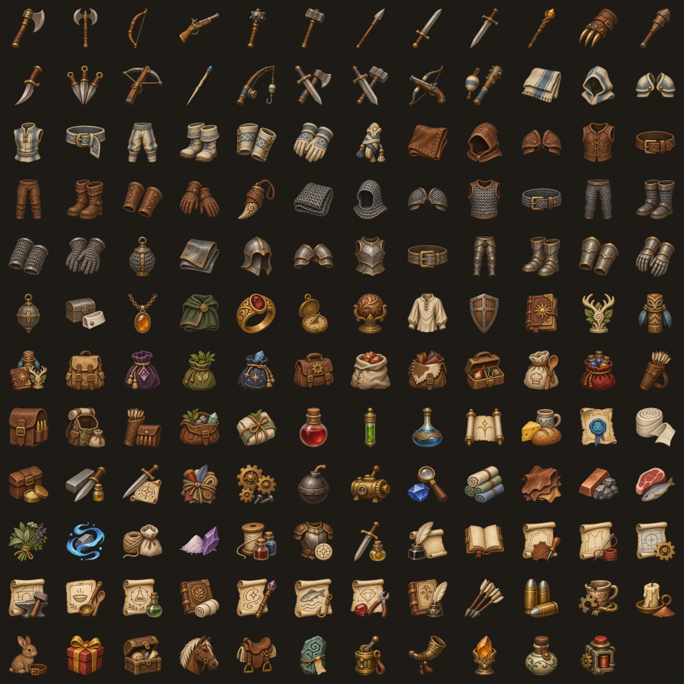

# Browse subcategory artwork

Browse keeps its existing top-level category paintings and gives 143 recognized
subcategory/filter combinations their own original paintings. This includes weapon
families and individual weapon types; cloth, leather, mail and plate slots;
jewelry, relics, bags, consumables, crafting supplies, recipes and miscellaneous
goods. The runtime gallery below follows the manifest's reading order.



The source inventory is [manifest.json](../../../assets/auction-subcategories/manifest.json).
Its eleven generated PNG sheets are preserved alongside it. Runtime art lives in
`!!!TwichUI/media/auction/categories/`: each picture has a 64px TGA and a 32px
`-small` TGA. The existing shape-based alpha cleaner removes source haze, then the
premultiplied resampler fits each silhouette with a transparent sampling margin.
Colors and aspect ratios are retained. Nothing is recolored at runtime.

```sh
python3 tools/make_auction_category_art.py --contact-sheet /tmp/auction-category-art.png
```

`--out DIR` rebuilds the textures elsewhere for comparison. `--write-mapping`
also regenerates the marked lookup tables in `auction/Categories.lua` from the
manifest. All normal Browse rows use the 64px file; consumers drawn at 26 units or
less use the small file through `W.UI.Art(texture, "auction:<id>", size)`.

Selection uses native class, subclass and inventory-type filters, never English
labels or ordinal positions. Grouped categories use their complete, deduplicated
class/subclass signature, so One-handed weapons has its own painting rather than
borrowing the first child's axe. Robes and chest armor share the matching
material's Chest painting. The facts follow the Forever client's
`Blizzard_AuctionHouseUI/Camelot/Blizzard_AuctionData.lua` hierarchy and documented
item enums. The client still supplies the categories and localized names; no
category, filter, query or auction behavior is added or changed. A future unknown
filter retains the existing safe category fallback.

Verification covers all 143 manifest mappings, translated/reordered filters,
group signatures, Chest/Robe aliases, valid alpha-bearing TGA files, distinct
image bytes and transparent margins. The expanded synthetic `categories` preview
includes crafting supplies, grouped weapons and nested armor slots. Neither the
gallery nor the simulator establishes real-client appearance at every UI scale.

No new diagnostics scope or gauge is needed: the lookup is bounded by the copied
native filters and runs while existing rows are populated. It adds no events,
hooks, timers, frame pools, saved data or background work.
