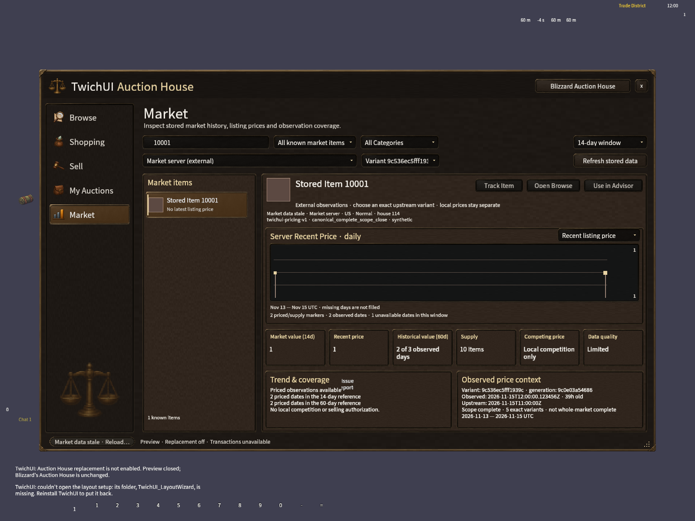
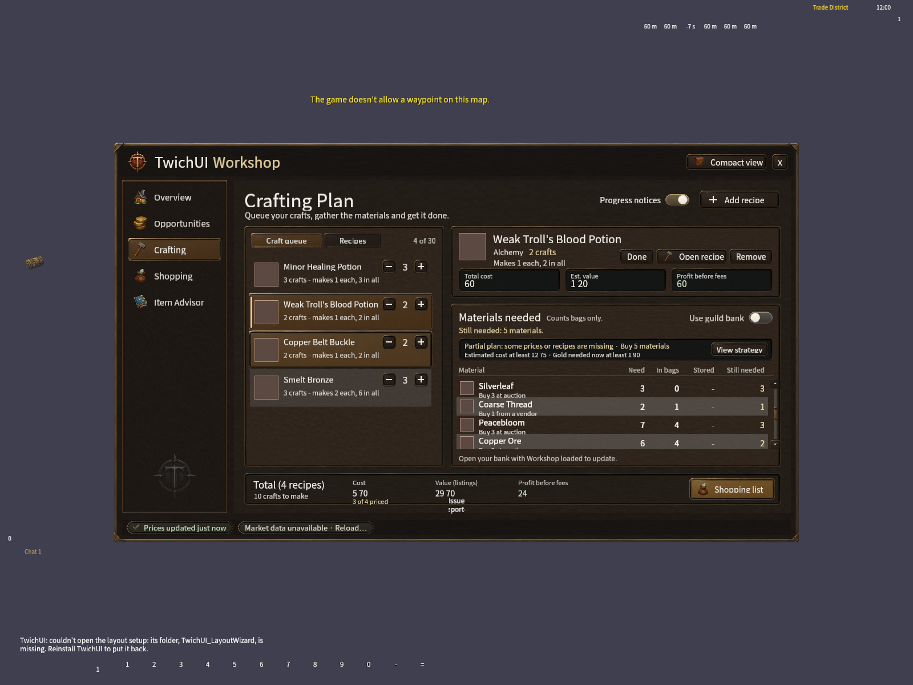

# M2 loaded Market data and manual reload

The companion performs opt-in archive synchronization, exact selection, 2 MiB canonical / 3 MiB Lua
generation and confirmed single-installation delivery. This addon remains a data-only consumer.
Installed `MarketDelivery.json` capability 1 declares schema 3 / contract 1 / transport 1 support.
Legacy schemas 1/2 and receipt schema 1 remain supported. The marker declares compatibility; it does
not authenticate a payload or weaken integrity validation.

Workshop and AH preview footers show a loaded-data chip. Hover exposes generation, source/algorithm,
market identity, observation time/age, schema/integrity, selected coverage and UTC window. Ready is
at most two hours old, aging up to 24 hours, stale older. Unknown/ahead-of-client clocks stay unknown.
Age is evaluated on rendering/interaction and never initiates sync or reloads. Missing, validating,
rejected and unsupported states preserve local functionality and last-good external generations.

Receipt preparation time is explicitly **not a file delivery receipt**. Actual file delivery belongs
in the companion. WoW cannot detect changed Data.lua bytes while running. The addon never infers a
pending file from source age or treats publication as client consumption. Local scans, history,
pricing defaults and competition evidence are unchanged.

The chip's **Reload…** action opens Reload UI / Cancel confirmation. It warns to finish unsaved edits
and that current interactions will close. Opening and acceptance both recheck experimental consent
and combat. No automatic reload or gameplay action is introduced; existing persistence remains intact.

## Verification

- Unit-tested freshness thresholds/future clocks, loaded generation/scope, last-good replacement,
  unsupported schemas and explicit reload/combat/consent guards.
- Development Market: 25 modules pass; AH: 18; Workshop Settings: 12; Advisor: 3. Four older window
  fixtures now include the actual bridge dependencies from the TOC. Initial missing-dependency failures
  are retained; no production fallback or assertion was weakened.
- Cloud simulator: seven AH launches (legacy/scoped priced/outside/absent/unknown/corrupt/future) pass.
  Workshop craft plus deliberate wrong-expectation control pass, including 531 modeled assertions.
  Existing classified voice-settings/string limitations remain disclosed. No native-client acceptance.
- Authenticated synthetic FastAPI → Rust archive → automatic publication → production Lua reader
  passes canonical and provisional algorithms. Independent checks cover exact copper, variants, UTC
  history, gaps/absence/bid-only supply, incremental updates, no-op files and over-budget refusal.

Pinned prebuilt simulator/reference revisions are unchanged. A workspace-only bwrap launcher adds an
empty tmpfs `/mnt` to permit the existing `/mnt/c` sandbox mapping on this Cloud image. Host/game data
stay hidden and networking stays isolated; addon code, simulator assertions and references are untouched.

Captures were inspected for the new controls. They do not establish native fonts/wrapping, real input,
combat/taint, reload persistence or Forever performance. Market `docs/market-auto-delivery-m2.md`
contains exact signed-companion setup, real-client/L4 measurements and rollback instructions.

No public addon release. Owner-PC installation, production deployment and formal L4 remain independent
gates. Next Advisor milestone is a separately reviewed source-qualified lightweight summary index;
M2 does not implement that runtime or treat asking prices as verified local competition.
